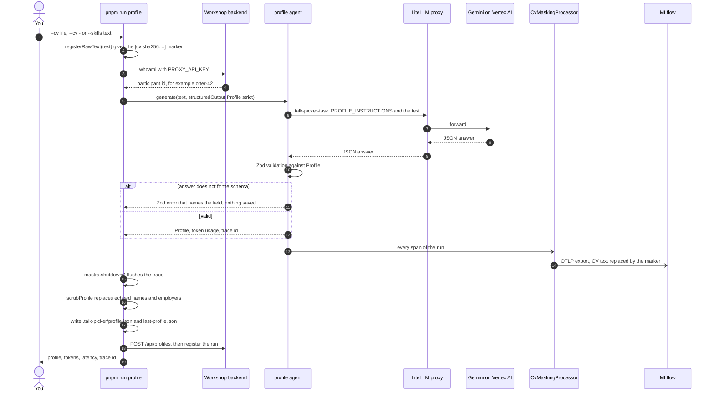
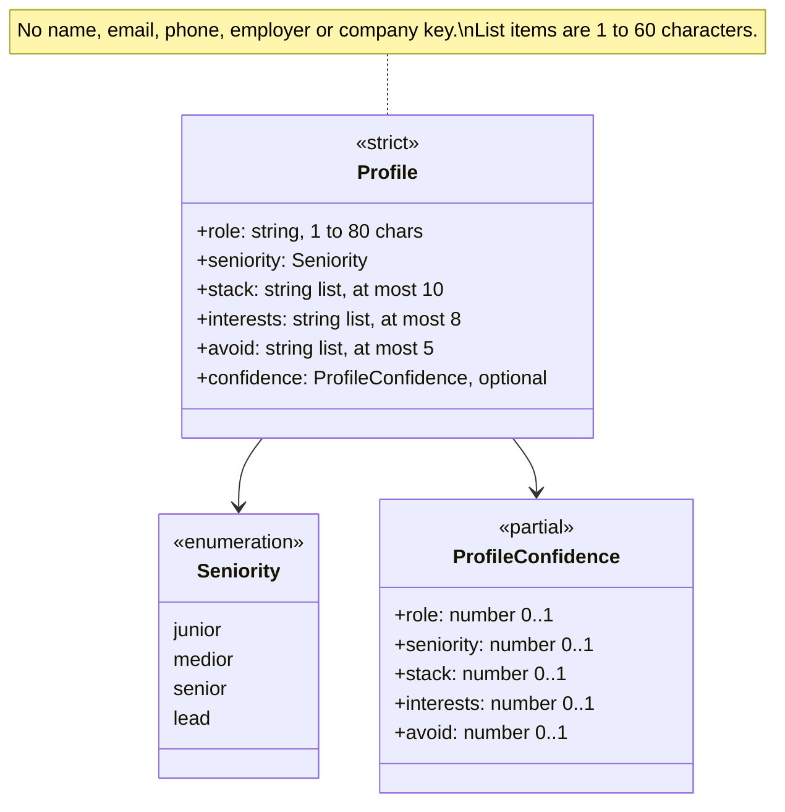

# talk-picker

**Production Agentic AI in TypeScript: Build a Self-Improving Talk Picker with Mastra, MLflow and GEPA**
Frontmania 2026, Jaarbeurs Utrecht, Wednesday 7 October, 11:00 to 12:45.

## You are on 01-done: the solved exercise

This branch is `01-start` plus the solution of exercise 1, CV to typed
profile. One agent reads a CV, or a line of typed skills, and returns a
`Profile` object: role, seniority, stack, interests and topics to avoid.

The solution has two parts, and each one does a different job:

- **The schema decides the shape.** `Profile` in `src/schemas/profile.ts`
  bounds every array, allows four seniority levels, and has no field for a
  name, employer or contact detail. `.strict()` rejects any extra key. The
  model's answer is validated against it, so a profile either fits or the
  run fails with a Zod message that names the field.
- **The instructions decide the content.** `PROFILE_INSTRUCTIONS` in
  `src/mastra/agents/profile.ts` says what to extract, how to grade seniority
  when the CV gives no years, and what must never appear in the output.

The repo adds two guards that you did not write. The trace masker replaces
your CV text with a `[cv:sha256:…]` marker before any span leaves the
process. The echo scrub replaces a name or employer that the model copied
into a value before the profile is saved or sent.

A valid profile is not the same as a correct one. `pnpm check:01` proves
the shape and the masking. It cannot prove the content. That is the point
of the debrief.

### If you came here because you were stuck

You switched with `pnpm run switch 01-done` (or `git stash` and
`git checkout 01-done`). Your own edits are in `git stash list`;
`git stash pop` on `01-start` brings them back after the session. On this
branch, steps 1 and 2 are done. Run step 3:

1. Make a profile. Pick one input:

   ```
   pnpm run profile --cv data/cvs/02-senior-react-architect.md
   pnpm run profile --cv -          # your own CV: paste it, then Ctrl-D on an empty line
   pnpm run profile --skills "what you do, what you want to see, what you want to avoid"
   ```

   Write it with `run`. Plain `pnpm profile` is a pnpm builtin and prints
   `ERR_PNPM_NOT_IMPLEMENTED`.

2. Check it:

   ```
   pnpm check:01
   ```

   Done is `check:01 passed: 16 OK, 0 FAIL, 0 BLOCKED (static + live, <ms> ms)`
   with a `masked: yes …` line. A `waiting for trace …` line may appear first,
   because the exporter batches. If the trace is still not found, run
   `pnpm check:01` again.

3. Workbook, block 1: copy the tokens and the latency from the line
   `OK      numbers for the workbook: tokens: <n>  latency: <ms> ms`.
   If it says `n/a`, copy the `tokens: …  latency: … ms` line that
   `pnpm run profile` printed.

The check passes on this branch, and it counts the same as on your own
branch. A profile made here is just as good for the rest of the day: block 2
ranks talks for it and the 11:35 optimizer dataset takes it in. Nobody
checks which branch it came from.

No backend or no wifi? Run it offline:

```
MODEL_MODE=mock pnpm run profile --cv data/cvs/02-senior-react-architect.md
pnpm check:01 --static
```

The mock ignores your input and returns one canned profile; its token and
latency numbers are fake (`participant: mock` is the sign). They never go
in the workbook; take the trainer's numbers in the debrief. A mock run also
overwrites `.talk-picker/profile.json`, so run `pnpm run profile` once more
without `MODEL_MODE=mock` when the backend is back.

### What the solution looks like

#### Step 1: the `Profile` schema

`src/schemas/profile.ts`, the object after the edit:

```ts
export const Profile = z
  .object({
    /** What the person does, one short phrase, no employer name ("front-end architect at a logistics scale-up"). */
    role: z.string().min(1).max(MAX_ROLE_LENGTH),
    seniority: Seniority,
    /** Technologies actually used, most recent first. */
    stack: z.array(Item).max(MAX_STACK),
    /** Topics the person wants to see talks about. */
    interests: z.array(Item).max(MAX_INTERESTS),
    /** Topics the person does not want; the ranker treats these as hard filters. */
    avoid: z.array(Item).max(MAX_AVOID),
    confidence: ProfileConfidence.optional(),
  })
  .strict();
```

The three `.max()` calls are the exercise: `MAX_STACK = 10`,
`MAX_INTERESTS = 8`, `MAX_AVOID = 5`. They keep the ranking prompt in
exercise 2 small and predictable: a profile is a handful of facts, not the
CV in another shape. `Item` is `z.string().min(1).max(60)` and `role` is at
most 80 characters, so a CV sentence does not fit either.

There is no `name`, `email`, `phone`, `employer` or `company` key, and
`.strict()` turns any extra key into a validation error. The model cannot
return what the schema has no room for, and the backend rejects such keys
too (`infra/backend/src/profile-guard.ts`).

The optional `confidence` field is stretch 1, solved for comparison:

```ts
/** Stretch (exercise 1): how sure the agent is per field, 0 to 1. Optional, so the check accepts both. */
export const ProfileConfidence = z
  .object({
    role: Confidence,
    seniority: Confidence,
    stack: Confidence,
    interests: Confidence,
    avoid: Confidence,
  })
  .partial();
```

`.optional()` on the field and `.partial()` on the object keep every
existing profile valid. `PROFILE_INSTRUCTIONS` on this branch does not ask
for confidence, so the stretch's second half (one line in the instructions)
is yours to try.

#### Step 2: `PROFILE_INSTRUCTIONS`

`src/mastra/agents/profile.ts`:

```ts
export const PROFILE_INSTRUCTIONS = `You turn a CV, or a typed list of skills, into a conference-attendee profile.
The profile picks afternoon talks for this person; it is not a summary of the CV.

Extract exactly these fields:
- role: what the person does, in one short phrase (under 80 characters), without any employer or product name
  (for example "front-end architect at a logistics scale-up", "junior Angular developer in government").
- seniority: one of junior, medior, senior, lead.
  When years of experience are stated: under 2 years is junior, 2 to 5 is medior, 5 to 10 is senior,
  more than 10 is senior unless the person owns a team, a platform or an architecture, which is lead.
  When years are not stated: owning a team or the architecture is lead, leading projects or mentoring
  others is senior, a first job or a study is junior, everything else is medior. In doubt, pick the lower level.
- stack: up to 10 technologies the person actually uses, most recent first. Skip tools mentioned once in passing.
- interests: up to 8 topics the person would want to see a talk about, taken from what they build and what they say they want to learn.
- avoid: up to 5 topics the person does not want; only what the text says or clearly implies, never a guess.

Rules:
- Never output names, employers, clients, cities, email addresses, phone numbers, links or anything else that identifies the person.
- Vague or short input gives shorter arrays and a lower seniority, never invented details.
- Write every value in English, even when the input is Dutch. Keep each array item short (one to four words).
- Answer only with the requested structure.`;
```

The first two lines set the job: a profile for picking talks, not a CV
summary. Without them the model pads `interests` with the whole skills list.

The seniority rule with numbers makes the model grade from years and
ownership instead of copying "Principal" or "Senior" from a job title. "In
doubt, pick the lower level" and "never invented details" make a vague input
give a short, honest profile.

The privacy rule matters because `role` is a free string: "front-end
developer at Hexaloop Logistics" fits in 80 characters. The schema restricts
keys, not values, so the instruction is the first guard on content and the
echo scrub is the second. The text sits in a template literal, so it contains
no backtick and no `${`.

The agent itself is given and unchanged:

```ts
export const createProfileAgent = (model: ProfileAgentModel) =>
  new Agent({
    id: PROFILE_AGENT_ID,
    name: 'profile',
    instructions: PROFILE_INSTRUCTIONS,
    model,
  });
```

#### Step 3: what `pnpm run profile` does

`scripts/profile/run.ts` runs the agent with structured output, validated
against your schema (`errorStrategy: 'strict'`), and tags the trace with your
pseudonym:

```ts
const result = await mastra.getAgent('profile').generate(text, {
  structuredOutput: { schema: Profile, errorStrategy: 'strict' },
  tracingOptions: { metadata: { participantId, kind: 'profile' } },
});
```

Before the call, the raw text is registered with the masking registry
(`registerRawText`), which is how the masker knows what to replace in every
span. After the call, `mastra.shutdown()` flushes the trace, `scrubProfile`
replaces echoed identity values, and only then is the profile written and
posted.



The class diagram of what you built in step 1:



`pnpm check:01` proves this in two layers. The static layer (11 lines,
offline, mock model) tests the bounds, the enum, the missing identity keys,
the instructions and a mock run. The live layer finds your last run at the
backend, looks for the hash marker in the trace, checks that no CV line is
in it, and prints the numbers for the workbook.

### Next

Exercise 2 starts at 11:32:

```
pnpm run switch 02-start
```

Your profile in `.talk-picker/profile.json` is git-ignored and stays where
it is; `pnpm plan` in exercise 2 ranks talks for it.

## The workshop

In 105 minutes you build an agent that reads your CV and picks your Frontmania
talk for 14:15, 15:30 and 16:30, with every step traced and your CV masked;
then you watch the room's feedback rewrite the ranking prompt and you judge,
with the numbers on screen, whether it got better.

| Clock | Segment                                                         | Branch                  |
| ----- | --------------------------------------------------------------- | ----------------------- |
| 11:00 | Welcome, blind pick, Codespace, privacy, demo                   | `00-setup`              |
| 11:12 | Block 1: CV to typed profile (6 theory, 11 exercise, 3 debrief) | `01-start` -> `01-done` |
| 11:32 | Block 2: ranker per slot plus retrieval (7, 14, 4)              | `02-start` -> `02-done` |
| 11:57 | Two-day training and flyer                                      |                         |
| 11:59 | Block 3: agent with tools plus feedback (6, 15, 5)              | `03-start` -> `03-done` |
| 12:25 | Reveal: score before and after, prompt diff, alias move         | `final` (trainer)       |
| 12:37 | Production checklist, closing                                   |                         |

The models are Gemini on Google Vertex AI behind a LiteLLM proxy run by the
trainer. You never hold a Google key: the proxy key in `.env` is all you
need. Archive search (exercise 2) uses the `text-embedding-005` embedding
model, 768 dimensions.

## Start here

1. Open the repo in a Codespace:
   [Open in GitHub Codespaces](https://codespaces.new/Randynamic/frontmania-ai-workshop?quickstart=1)
   (the prebuild has already installed everything). The same URL is on the
   first slide and on your card. Or locally with Node 22: `corepack enable`,
   `pnpm install --frozen-lockfile`, `cp .env.example .env`.
2. Get your `.env` from the key page <https://key-picker-788920378573.europe-west4.run.app> (QR and room code on the first
   slide) and paste it over `.env`, or paste a reserve card's key as `PROXY_API_KEY`. It is the only
   secret you get; it authenticates the model proxy, trace ingestion and the
   workshop backend. It dies at 13:00.
3. Run `pnpm run doctor`. Every line must say `OK`; the last line prints your
   id, for example `You are otter-42`. (`pnpm doctor` without `run` starts
   pnpm's own built-in doctor, which is not this script.)
4. Open the blind-pick page on your phone (QR on the screen, or
   `<WORKSHOP_BACKEND_URL>/pick`), enter the id and the 8-character pick code
   from your card, and pick one talk per afternoon slot before the demo
   starts. Your picks are final once saved (a second submit answers 409, a
   wrong code 403), so check them before you submit.

## Privacy

- Your CV goes to Google (Vertex AI, region Netherlands) through our proxy to build your profile. We don't store it.
- CV text is masked in traces. We keep your profile and picks under a pseudonym.
- Your `pnpm ask` question, your plan and your feedback reasons also go to Google Vertex AI through our proxy, and stay in the traces until 18:00.
- All workshop data is deleted today at 18:00.
- Prefer not to? Use a sample CV or type your skills.

`pnpm run profile` never writes your CV to disk; traces carry a hash marker
(`[cv:sha256:...]`) where the text was, also when a model echoes only your
name or employer. Those are read from the text itself, markdown or plain: the
capitalised words of its first three lines, every capitalised word that is
not a heading, job title or technology, and, in any letter case, the value
after a `Name:` or `Naam:` label, links and `@handles`, Dutch postcodes and
the word after "at" or "bij" (`src/observability/identity-fields.ts`). A name
you write only in lowercase and without a label is not recognised. See `src/observability/mask.ts` (the processor),
`src/observability/identity-hints.ts` (name, employer and place fragments),
`src/mastra/index.ts` (where it is wired into every trace) and
`src/mastra/index.test.ts` (an agent run whose exported spans carry the
marker and none of the CV). The profile itself has no name, employer or
contact field by schema (exercise 1), and `pnpm run profile` replaces any
name or employer the model echoes inside a value with the same hash marker
before the profile is saved or sent (`src/observability/echo-scrub.ts`).

Using your own CV? Paste it instead of saving it: run
`pnpm run profile --cv -`, paste the text, then press Ctrl-D on an empty line.
Nothing is written to disk. If you do save it as a file, use `private/cv.md`
(`mkdir -p private` first): `private/` is git-ignored, so it cannot be
committed by mistake, and `pnpm run switch` leaves it where it is (a CV
elsewhere in the tree would be stashed away on the next branch change).

In a GitHub Codespace every file, a saved CV included, sits on GitHub
(Microsoft) infrastructure until you delete the Codespace. Who owns it depends
on a setting the trainer chooses: under User ownership (the default for this
workshop) it is owned and paid for by your own GitHub account, Upgraide cannot
open it and our 18:00 deletion cannot reach it; under Organisation ownership
the organisation pays for it and Upgraide deletes it at 18:00. The trainer
says which one applies at the start. Either way, before you leave today:
`rm -rf private/`, then delete the Codespace at <https://github.com/codespaces>
(`...` menu, Delete).

## Branches

| Command                    | What you get                                                                                   |
| -------------------------- | ---------------------------------------------------------------------------------------------- |
| `pnpm run switch 00-setup` | foundation: Mastra instance with masked tracing, data, infra, shared schemas; no exercise code |
| `pnpm run switch 01-start` | exercise 1 skeleton: Profile schema and profile agent instructions                             |
| `pnpm run switch 01-done`  | exercise 1 solved (you are here)                                                               |
| `pnpm run switch 02-start` | exercise 2 skeleton: rankSlot, parallel fan-out, retrieval tip                                 |
| `pnpm run switch 02-done`  | exercise 2 solved                                                                              |
| `pnpm run switch 03-start` | exercise 3 skeleton: submitFeedback tool, planner agent with three tools                       |
| `pnpm run switch 03-done`  | exercise 3 solved                                                                              |
| `pnpm run switch final`    | 03-done plus the trainer-only optimizer (`optimize/`, Python)                                  |

Each exercise has a done criterion: `pnpm check:01`, `check:02`, `check:03`.
It fails on the start branch with a message that names what is missing and
passes on the done branch. This branch has `check:01`; the later checks
arrive with their exercises.

`pnpm run switch <branch>` keeps your work and changes branch in one go: it
runs `git stash --include-untracked` when you have changes, then
`git checkout <branch>` (a plain `git checkout` refuses to leave a branch whose
exercise files you edited). Your work stays in `git stash list`; `.env`,
`.talk-picker/` and `private/` are git-ignored and stay where they are.

**Stuck for 8 minutes? `pnpm run switch NN-done` and keep going. Nobody checks.**
By hand it is two lines: `git stash --include-untracked`, then `git checkout NN-done`.

## When it misbehaves

| Symptom                           | Fix                                                                                                                                         |
| --------------------------------- | ------------------------------------------------------------------------------------------------------------------------------------------- |
| proxy 401                         | wrong key: re-paste `PROXY_API_KEY` in `.env`                                                                                               |
| proxy 429                         | you hit the per-key rate cap; wait 10 seconds                                                                                               |
| `ERR_PNPM_NOT_IMPLEMENTED`        | you typed `pnpm profile`; write `pnpm run profile` (and `pnpm run doctor`: plain `pnpm doctor` is pnpm's own doctor)                        |
| Zod error from `pnpm run profile` | the model's answer broke the schema; the message names the field, run it again (structured output is validated, not guaranteed)             |
| trace not found                   | the exporter batches; wait 10 seconds and run the check again                                                                               |
| `pnpm check:01` trace never found | your last `pnpm run profile` was a mock run (`participant: mock`); run it again without `MODEL_MODE=mock`, then the check                   |
| backend unreachable at `<url>`    | the message names the host and the cause; run the same command with `MODEL_MODE=mock` in front to keep working offline and tell the floater |
| `pnpm run doctor` FAIL on data    | ask the floater: the trainer rebuilds the vector index (`pnpm ingest` needs a trainer key); a missing file is `git checkout -- data`        |

## What is deliberately not here

Memory, streaming to the UI, chunking strategies, evals as a safety net,
deployment. Today you build one workflow and see one optimization run. In two
days you build memory, streaming to the UI, chunking strategies and evals as
a safety net, up to production:
[academy.upgraide.nl/frontmania](https://academy.upgraide.nl/frontmania?utm_source=flyer&utm_medium=print&utm_campaign=frontmania-workshop)
(22 to 23 November or 12 to 13 December 2026, EUR 807.50 excl. VAT with the
Frontmania discount, max 20 per session).

## Developer commands

`pnpm typecheck`, `pnpm lint`, `pnpm test`, `pnpm test:coverage`,
`pnpm format` (Prettier check), `pnpm check:01 --static` (offline, what CI
runs). Trainer-side: `pnpm keys:create`, `pnpm keys:revoke`,
`pnpm data:delete`, `pnpm smoke`, `pnpm ingest`; the stack itself is in
`infra/` (see `infra/README.md`).
