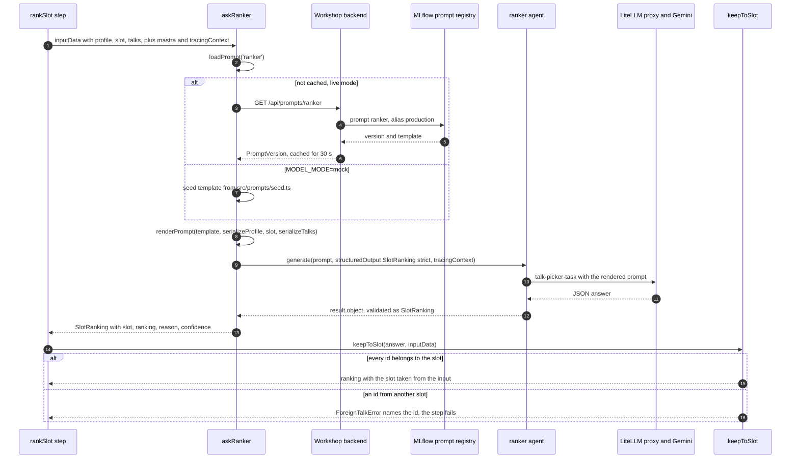
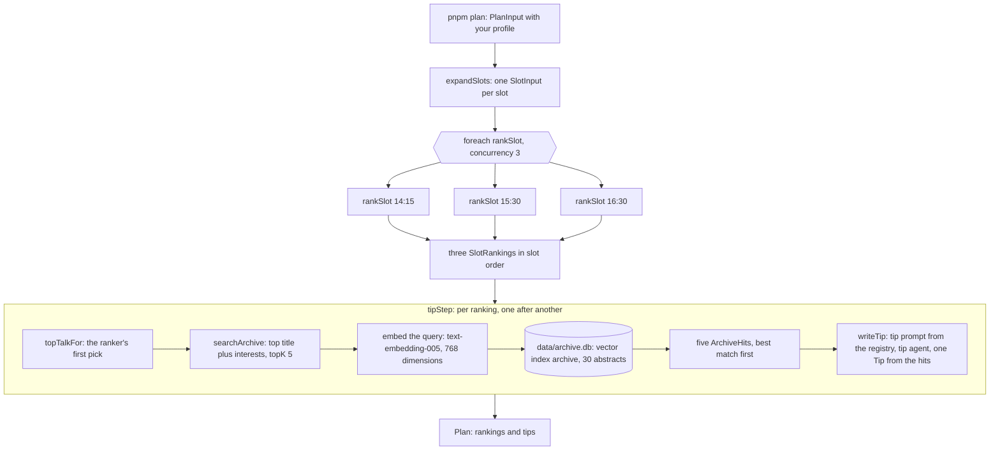

# talk-picker

**Production Agentic AI in TypeScript: Build a Self-Improving Talk Picker with Mastra, MLflow and GEPA**
Frontmania 2026, Jaarbeurs Utrecht, Wednesday 7 October, 11:00 to 12:45.

## You are on 02-done: the solved exercise

This branch is `02-start` plus the solution of exercise 2, ranker per slot
plus retrieval. The `plan` workflow takes your profile and returns an
afternoon plan: a ranking of the talks in each slot (14:15, 15:30, 16:30)
and one tip per slot, a recorded talk from the 2025 edition found through
vector search.

The solution makes three choices, each for a reason you will see again at
the reveal:

- **The prompt lives in a registry, not in the code.** `askRanker` loads the
  prompt `ranker` from the MLflow prompt registry by its alias `production`.
  When the optimizer's better prompt gets that alias at 12:31, the ranking
  changes without a code change or a deploy.
- **The three slots are ranked in parallel.** `.foreach(rankSlot, { concurrency: 3 })`
  runs three model calls at once. Same tokens, less waiting: the step takes
  as long as the slowest call.
- **The archive sits behind retrieval, not in the prompt.** The tip step
  sends the five closest archive talks to the model, not all 30. `pnpm compare`
  puts numbers on that choice.

### If you came here because you were stuck

You switched with `pnpm run switch 02-done` (or `git stash` and
`git checkout 02-done`). Your own edits are in `git stash list`;
`git stash pop` on `02-start` brings them back after the session. Steps 1
and 2 are done here, and step 3 has nothing to edit. Run the three commands:

```
pnpm plan
pnpm compare
pnpm check:02
```

No `.talk-picker/profile.json` from block 1? Then start with a persona
profile, the one closest to you:

```
pnpm plan --profile data/cvs/profiles/02-senior-react-architect.json
```

When you have no profile of your own, that first `--profile` run also saves
the persona as `.talk-picker/profile.json`, so later runs need no flag.
`pnpm compare` reuses the profile of the last `pnpm plan`.

Copy three things into the workbook, block 2:

- the three talk ids from the `top picks:` line of `pnpm plan` (the baseline
  for the rerun at 12:33);
- the `in-prompt` and `retrieval` rows of `pnpm compare`: tokens and latency;
- the `numbers for the workbook` line of `pnpm check:02`.

Done is `check:02 passed: 19 OK, 0 FAIL, 0 BLOCKED (static + live, <ms> ms)`.
A `WARN last compare run` line with 18 OK also passes; it only means
`pnpm compare` has not run yet. `02-done` already runs in parallel, so take
the sequential latency for comparison from the trainer's slide.

The check passes on this branch, and it counts the same as on your own
branch. The three ids from here are just as good a baseline for 12:33.
Nobody checks which branch they came from.

No backend or no wifi? `pnpm check:02 --static` runs offline, and
`MODEL_MODE=mock pnpm plan --profile data/cvs/profiles/02-senior-react-architect.json`
runs the workflow with canned answers. Mock numbers never go in the
workbook; write the three ids only from a live run.

### What the solution looks like

#### Step 1: `askRanker` ranks one slot

`src/mastra/workflows/steps/rank-slot.ts`:

```ts
export const askRanker = async ({
  inputData,
  mastra,
  tracingContext,
}: AskRankerParams): Promise<SlotRanking> => {
  const { profile, slot, talks } = inputData;
  const { template } = await loadPrompt('ranker');
  const prompt = renderPrompt(template, {
    profile: serializeProfile(profile),
    slot,
    talks: serializeTalks(talks),
  });
  const result = await mastra.getAgent('ranker').generate(prompt, {
    structuredOutput: { schema: SlotRanking, errorStrategy: 'strict' },
    tracingContext,
  });
  return result.object;
};
```

`loadPrompt('ranker')` fetches the template through the workshop backend
(`GET /api/prompts/ranker`, alias `production`) and caches it for 30 seconds,
so one run uses one version. In `MODEL_MODE=mock` the seed template from
`src/prompts/seed.ts` stands in.

`serializeProfile` and `serializeTalks` turn the objects into the exact
strings the trainer's Python optimizer renders too (a contract test on
`final`, `optimize/contract_test.py`, holds the two sides identical), so GEPA
optimizes the prompt you actually run.

`errorStrategy: 'strict'` turns a malformed answer into a failed step with a
Zod message, instead of a bad ranking that travels on quietly.
`tracingContext` nests the model call under the workflow trace; without it
each ranker call starts its own trace and the check cannot tie the three
spans to your plan.

The step around it is given. `keepToSlot` sets the answer's slot from the
input and fails with a message when the model names a talk from another
slot, because structured output validates the shape, not the content:

```ts
export const rankSlot = createStep({
  id: 'rankSlot',
  inputSchema: SlotInput,
  outputSchema: SlotRanking,
  execute: async (params) => keepToSlot(await askRanker(params), params.inputData),
});
```



#### Step 2: the fan-out

`src/mastra/workflows/plan.ts`:

```ts
export const RANK_CONCURRENCY = 3;

export const planWorkflow = createWorkflow({
  id: PLAN_WORKFLOW_ID,
  inputSchema: PlanInput,
  outputSchema: Plan,
})
  .then(expandSlots)
  .foreach(rankSlot, { concurrency: RANK_CONCURRENCY })
  .then(tipStep)
  .commit();
```

`expandSlots` returns an array with one `SlotInput` per slot, which is what
`.foreach` iterates over. With `concurrency: 1` the three ranker calls run
one after another; with 3 they overlap, and the check proves it from the
trace: three `rankSlot` spans whose time windows overlap. The latency does
not drop to a third, because the tip step still writes its three tips one
after another in a `for` loop.

#### Step 3: retrieval in the tip step (given)

`src/mastra/workflows/steps/tip.ts` was already complete on `02-start` and is
unchanged here. Read the loop:

```ts
for (const ranking of inputData) {
  const topTalk = topTalkFor(ranking);
  const hits = searchArchiveHits(
    await searchArchive.execute(
      { queryText: `${topTalk.title} ${profile.interests.join(' ')}`, topK: 5 },
      { mastra },
    ),
  );
  const tip = await writeTip(ranking, hits, profile, { mastra, tracingContext });
  if (tip) tips.push(tip);
}
```

The query is the top talk's title plus your interests, so the tip prepares
you for the talk you will see, in the direction you care about.
`searchArchive` embeds the query (`talk-picker-embed` on the proxy, which is
`text-embedding-005`, 768 dimensions) and asks the libSQL vector index
`archive` in `data/archive.db` for the five nearest of the 30 abstracts. The
tip agent must pick one of those five; an id outside the hits fails the
step.

`pnpm compare` runs the tip prompt for 14:15 twice: once with all 30 archive
abstracts in the prompt, once with the top 5 from `searchArchive`. The
difference in tokens and latency is the in-prompt versus retrieval decision,
with your own numbers.



`pnpm check:02` proves this in two layers. The static layer (10 lines,
offline, mock model, seed prompts) checks the markers, the fan-out setting
and a mock run of the whole workflow. The live layer reads your last plan,
finds its trace at the backend, counts three overlapping `rankSlot` spans,
and prints the numbers for the workbook.

### Next

Exercise 3 starts at 11:59:

```
pnpm run switch 03-start
```

`.talk-picker/` (your profile and last plan) is git-ignored and stays where
it is.

## The workshop

In 105 minutes you build an agent that reads your CV and picks your Frontmania
talk for 14:15, 15:30 and 16:30, with every step traced and your CV masked;
then you watch the room's feedback rewrite the ranking prompt and you judge,
with the numbers on screen, whether it got better.

| Clock | Segment                                                         | Branch                  |
| ----- | --------------------------------------------------------------- | ----------------------- |
| 11:00 | Welcome, blind pick, Codespace, privacy, demo                   | `00-setup`              |
| 11:12 | Block 1: CV to typed profile (6 theory, 11 exercise, 3 debrief) | `01-start` -> `01-done` |
| 11:32 | Block 2: ranker per slot plus retrieval (7, 14, 4)              | `02-start` -> `02-done` |
| 11:57 | Two-day training and flyer                                      |                         |
| 11:59 | Block 3: agent with tools plus feedback (6, 15, 5)              | `03-start` -> `03-done` |
| 12:25 | Reveal: score before and after, prompt diff, alias move         | `final` (trainer)       |
| 12:37 | Production checklist, closing                                   |                         |

The models are Gemini on Google Vertex AI behind a LiteLLM proxy run by the
trainer. You never hold a Google key: the proxy key in `.env` is all you
need. Archive search (exercise 2) uses the `text-embedding-005` embedding
model, 768 dimensions.

## Start here

1. Open the repo in a Codespace:
   [Open in GitHub Codespaces](https://codespaces.new/Randynamic/frontmania-ai-workshop?quickstart=1)
   (the prebuild has already installed everything). The same URL is on the
   first slide and on your card. Or locally with Node 22: `corepack enable`,
   `pnpm install --frozen-lockfile`, `cp .env.example .env`.
2. Get your `.env` from the key page <https://key-picker-788920378573.europe-west4.run.app> (QR and room code on the first
   slide) and paste it over `.env`, or paste a reserve card's key as `PROXY_API_KEY`. It is the only
   secret you get; it authenticates the model proxy, trace ingestion and the
   workshop backend. It dies at 13:00.
3. Run `pnpm run doctor`. Every line must say `OK`; the last line prints your
   id, for example `You are otter-42`. (`pnpm doctor` without `run` starts
   pnpm's own built-in doctor, which is not this script.)
4. Open the blind-pick page on your phone (QR on the screen, or
   `<WORKSHOP_BACKEND_URL>/pick`), enter the id and the 8-character pick code
   from your card, and pick one talk per afternoon slot before the demo
   starts. Your picks are final once saved (a second submit answers 409, a
   wrong code 403), so check them before you submit.

## Privacy

- Your CV goes to Google (Vertex AI, region Netherlands) through our proxy to build your profile. We don't store it.
- CV text is masked in traces. We keep your profile and picks under a pseudonym.
- Your `pnpm ask` question, your plan and your feedback reasons also go to Google Vertex AI through our proxy, and stay in the traces until 18:00.
- All workshop data is deleted today at 18:00.
- Prefer not to? Use a sample CV or type your skills.

`pnpm run profile` never writes your CV to disk; traces carry a hash marker
(`[cv:sha256:...]`) where the text was, also when a model echoes only your
name or employer. Those are read from the text itself, markdown or plain: the
capitalised words of its first three lines, every capitalised word that is
not a heading, job title or technology, and, in any letter case, the value
after a `Name:` or `Naam:` label, links and `@handles`, Dutch postcodes and
the word after "at" or "bij" (`src/observability/identity-fields.ts`). A name
you write only in lowercase and without a label is not recognised. See `src/observability/mask.ts` (the processor),
`src/observability/identity-hints.ts` (name, employer and place fragments),
`src/mastra/index.ts` (where it is wired into every trace) and
`src/mastra/index.test.ts` (an agent run whose exported spans carry the
marker and none of the CV). The profile itself has no name, employer or
contact field by schema (exercise 1), and `pnpm run profile` replaces any
name or employer the model echoes inside a value with the same hash marker
before the profile is saved or sent (`src/observability/echo-scrub.ts`).

Using your own CV? Paste it instead of saving it: run
`pnpm run profile --cv -`, paste the text, then press Ctrl-D on an empty line.
Nothing is written to disk. If you do save it as a file, use `private/cv.md`
(`mkdir -p private` first): `private/` is git-ignored, so it cannot be
committed by mistake, and `pnpm run switch` leaves it where it is (a CV
elsewhere in the tree would be stashed away on the next branch change).

In a GitHub Codespace every file, a saved CV included, sits on GitHub
(Microsoft) infrastructure until you delete the Codespace. Who owns it depends
on a setting the trainer chooses: under User ownership (the default for this
workshop) it is owned and paid for by your own GitHub account, Upgraide cannot
open it and our 18:00 deletion cannot reach it; under Organisation ownership
the organisation pays for it and Upgraide deletes it at 18:00. The trainer
says which one applies at the start. Either way, before you leave today:
`rm -rf private/`, then delete the Codespace at <https://github.com/codespaces>
(`...` menu, Delete).

## Branches

| Command                    | What you get                                                                                   |
| -------------------------- | ---------------------------------------------------------------------------------------------- |
| `pnpm run switch 00-setup` | foundation: Mastra instance with masked tracing, data, infra, shared schemas; no exercise code |
| `pnpm run switch 01-start` | exercise 1 skeleton: Profile schema and profile agent instructions                             |
| `pnpm run switch 01-done`  | exercise 1 solved                                                                              |
| `pnpm run switch 02-start` | exercise 2 skeleton: rankSlot, parallel fan-out, retrieval tip                                 |
| `pnpm run switch 02-done`  | exercise 2 solved (you are here)                                                               |
| `pnpm run switch 03-start` | exercise 3 skeleton: submitFeedback tool, planner agent with three tools                       |
| `pnpm run switch 03-done`  | exercise 3 solved                                                                              |
| `pnpm run switch final`    | 03-done plus the trainer-only optimizer (`optimize/`, Python)                                  |

Each exercise has a done criterion: `pnpm check:01`, `check:02`, `check:03`.
It fails on the start branch with a message that names what is missing and
passes on the done branch. This branch has `check:01` and `check:02`;
`check:03` arrives with exercise 3.

`pnpm run switch <branch>` keeps your work and changes branch in one go: it
runs `git stash --include-untracked` when you have changes, then
`git checkout <branch>` (a plain `git checkout` refuses to leave a branch whose
exercise files you edited). Your work stays in `git stash list`; `.env`,
`.talk-picker/` and `private/` are git-ignored and stay where they are.

**Stuck for 8 minutes? `pnpm run switch NN-done` and keep going. Nobody checks.**
By hand it is two lines: `git stash --include-untracked`, then `git checkout NN-done`.

## When it misbehaves

| Symptom                                      | Fix                                                                                                                                         |
| -------------------------------------------- | ------------------------------------------------------------------------------------------------------------------------------------------- |
| proxy 401                                    | wrong key: re-paste `PROXY_API_KEY` in `.env`                                                                                               |
| proxy 429                                    | you hit the per-key rate cap; wait 10 seconds                                                                                               |
| `ERR_PNPM_NOT_IMPLEMENTED`                   | you typed `pnpm profile`; write `pnpm run profile` (and `pnpm run doctor`: plain `pnpm doctor` is pnpm's own doctor)                        |
| Zod error from `pnpm run profile`            | the model's answer broke the schema; the message names the field, run it again (structured output is validated, not guaranteed)             |
| trace not found                              | the exporter batches; wait 10 seconds and run the check again                                                                               |
| `pnpm check:01` trace never found            | your last `pnpm run profile` was a mock run (`participant: mock`); run it again without `MODEL_MODE=mock`, then the check                   |
| backend unreachable at `<url>`               | the message names the host and the cause; run the same command with `MODEL_MODE=mock` in front to keep working offline and tell the floater |
| `pnpm plan` says no profile                  | run `pnpm run profile` first, or `pnpm plan --profile data/cvs/profiles/<persona>.json`                                                     |
| `pnpm plan` names a wrong talk id            | the ranker answered with an id outside the slot (`ForeignTalkError`); run it again                                                          |
| `pnpm plan` tip is not one of the candidates | the tip agent named an archive talk outside the five hits; run it again                                                                     |
| `pnpm check:02` overlap FAIL                 | the three `rankSlot` spans ran one after another: `plan.ts` says `concurrency: 1`; set it to 3 and run `pnpm plan` again                    |
| `pnpm run doctor` FAIL on data               | ask the floater: the trainer rebuilds the vector index (`pnpm ingest` needs a trainer key); a missing file is `git checkout -- data`        |

## What is deliberately not here

Memory, streaming to the UI, chunking strategies, evals as a safety net,
deployment. Today you build one workflow and see one optimization run. In two
days you build memory, streaming to the UI, chunking strategies and evals as
a safety net, up to production:
[academy.upgraide.nl/frontmania](https://academy.upgraide.nl/frontmania?utm_source=flyer&utm_medium=print&utm_campaign=frontmania-workshop)
(22 to 23 November or 12 to 13 December 2026, EUR 807.50 excl. VAT with the
Frontmania discount, max 20 per session).

## Developer commands

`pnpm typecheck`, `pnpm lint`, `pnpm test`, `pnpm test:coverage`,
`pnpm format` (Prettier check), `pnpm check:01 --static`,
`pnpm check:02 --static` (offline, what CI runs);
`MODEL_MODE=mock pnpm plan --profile data/cvs/profiles/<persona>.json` runs
the workflow offline with canned answers. Trainer-side:
`pnpm rank-once --profile <json> --slot <slot> [--render-only]` (the
contract-test partner of the optimizer), `pnpm keys:create`,
`pnpm keys:revoke`, `pnpm data:delete`, `pnpm smoke`, `pnpm ingest`; the
stack itself is in `infra/` (see `infra/README.md`).
