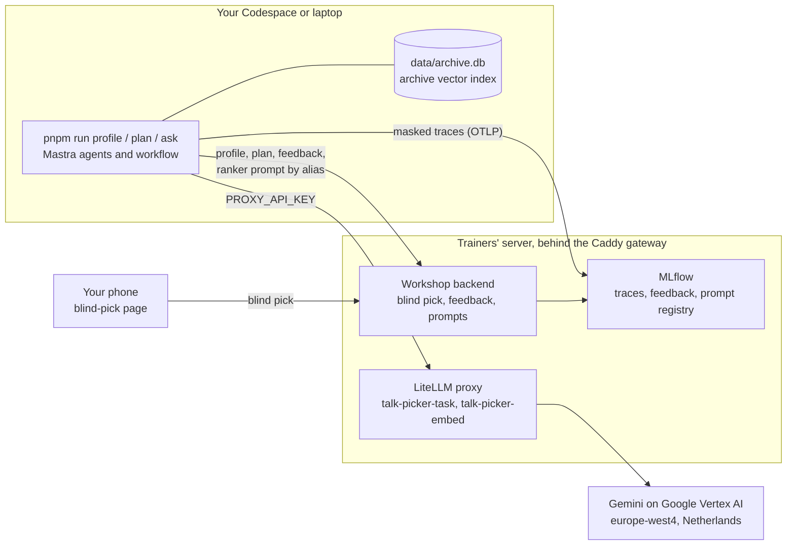
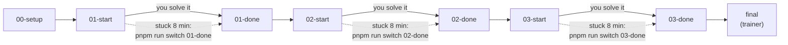

# talk-picker

**Production Agentic AI in TypeScript: Build a Self-Improving Talk Picker with Mastra, MLflow and GEPA**
Frontmania 2026, Jaarbeurs Utrecht, Wednesday 7 October, 11:00 to 12:45.

In 105 minutes you build an agent that reads your CV and picks your Frontmania
talk for the 14:15, 15:30 and 16:30 slots, with every step traced and your CV
masked. Then you watch the room's blind picks rewrite the ranking prompt, and
you judge, with the numbers on screen, whether it got better.

**You are on `00-setup`.** This branch has the foundation (a Mastra instance
with masked tracing, the conference data, the shared schemas and the
infrastructure) and no exercise code. Go to [Start here](#start-here).

## What you will build

**Exercise 1: CV to typed profile (`01-start` → `01-done`).** You write the
Zod `Profile` schema and the instructions of the profile agent, so
`pnpm run profile` turns a CV (yours, a sample, or a few typed skills) into a
validated, typed profile with no name, employer or contact field. The model
call is traced to MLflow with the CV text replaced by a hash marker.
`pnpm check:01` says when you are done.

**Exercise 2: a ranker per slot, plus retrieval (`02-start` → `02-done`).** You
write the `rankSlot` step: it renders the `ranker` prompt from the prompt
registry with your profile and one slot's talks, and the ranker agent answers
with a typed ranking. The `plan` workflow runs the three afternoon slots in
parallel, and a tip step adds one related recording per slot from the
Frontmania 2025 archive (a vector index in `data/archive.db`). `pnpm plan`
prints your afternoon; `pnpm check:02` checks that the three slots really ran
in parallel.

**Exercise 3: an agent with tools, plus feedback (`03-start` → `03-done`).**
You write the `submitFeedback` tool and give the planner agent three tools:
`getTimetable`, `searchArchive` and `submitFeedback`. `pnpm ask "plan my
afternoon, no Angular"` lets the agent decide which tools to call; your thumbs
up or down per slot land as feedback on your plan's trace in MLflow.
`pnpm check:03` finds your three verdicts there.

**The reveal (`final`, trainer).** While you work, the trainers run GEPA on the
room's profiles and blind picks. It writes a new version of the `ranker`
prompt in the MLflow prompt registry. At 12:25 you see the score before and
after on people GEPA never saw, and at 12:31 the `production` alias moves to
the new version: your next `pnpm plan` ranks with it, without a deploy.

### The whole system



You never configure Google. Your one key (`PROXY_API_KEY`) opens three doors
on the trainers' server: the model proxy, trace ingestion and the workshop
backend. The proxy exposes two model aliases to you: `talk-picker-task`
(Gemini 2.5 Flash, thinking off) and `talk-picker-embed` (text-embedding-005,
768 dimensions). A third alias, `talk-picker-reflect` (Gemini 2.5 Pro), is for
the trainers' optimizer only.

### The branches



Every block starts on its own `NN-start` branch, so falling behind in one block
never costs you the next one.

## Schedule

| Clock | Segment                                                         | Branch                  |
| ----- | --------------------------------------------------------------- | ----------------------- |
| 11:00 | Welcome, blind pick, Codespace, privacy, demo                   | `00-setup`              |
| 11:12 | Block 1: CV to typed profile (6 theory, 11 exercise, 3 debrief) | `01-start` -> `01-done` |
| 11:32 | Block 2: ranker per slot plus retrieval (7, 14, 4)              | `02-start` -> `02-done` |
| 11:57 | Two-day training and flyer                                      |                         |
| 11:59 | Block 3: agent with tools plus feedback (6, 15, 5)              | `03-start` -> `03-done` |
| 12:25 | Reveal: score before and after, prompt diff, alias move         | `final` (trainer)       |
| 12:37 | Production checklist, closing                                   |                         |

## Start here

### 1. Open the Codespace

[**Open in GitHub Codespaces**](https://codespaces.new/Randynamic/frontmania-ai-workshop?quickstart=1)

The prebuild has already installed Node 22, pnpm and every dependency, so
you start coding instead of downloading. When the editor is open, check the
branch in its terminal:

```sh
git branch --show-current
```

It must say `00-setup`. If it says something else (a new Codespace opens on
the repository's default branch), switch:

```sh
pnpm run switch 00-setup
```

**Or run it on your own laptop** with Node 22 (22.13 or newer) and git. These
commands pin pnpm to the repo's version, install exactly the locked
dependencies and create your `.env`:

```sh
git clone https://github.com/Randynamic/frontmania-ai-workshop.git talk-picker
cd talk-picker
git checkout 00-setup
corepack enable
pnpm install --frozen-lockfile
cp .env.example .env
```

### 2. Put your key in `.env`

Get your `.env` from the key page: <https://key-picker-788920378573.europe-west4.run.app> (scan the QR on the first slide; the
room code is on that slide too). Reserve key cards are with the floater.
Open `.env` in the editor and replace its content with the one you were given,
or, if you only got a key, paste it after `PROXY_API_KEY=`:

```sh
PROXY_API_KEY=sk-...
```

This one key is the only secret you get: it authenticates the model proxy,
trace ingestion and the workshop backend for you alone. It stops working at
13:00. `.env` is git-ignored, so it is never committed.

### 3. Run the doctor

```sh
pnpm run doctor
```

The doctor proves, before the first exercise, that your machine, your key, the
proxy, the backend and the tracing path all work, so a problem now does not
cost you exercise time later. Every line must say `OK` (the Node version may
differ slightly):

```text
OK   node      v22.23.3
OK   pnpm      12.6.0
OK   .env      4 keys present
OK   data      data/program-2026.json, data/archive.db (live index)
OK   proxy     talk-picker-task, talk-picker-embed available
OK   backend   ok, mlflow ok
OK   tracing   gateway and MLflow reachable
OK   identity  otter-42
You are otter-42. Use this id on the blind-pick page.
doctor finished in 412 ms, exit 0
```

Note your id (`otter-42` here). It is your pseudonym for the whole session.

Type `run`: `pnpm doctor` without it starts pnpm's own built-in doctor, which
is not this script. The same goes for `pnpm run profile` later.

### 4. Make your blind pick

Open the blind-pick page on your phone (QR code on the screen, or
`<WORKSHOP_BACKEND_URL>/pick` with the URL from your `.env`). Enter your id and
the 8-character pick code from your card or key page, and pick one talk per
afternoon slot before the demo starts.

Your blind picks are the ground truth the optimizer learns from and is scored
against at the reveal, so pick what you would really go to. Picks are final
once saved (a second submit answers 409, a wrong code 403), so check them
before you submit.

### 5. Go to exercise 1

Wait for the trainer's signal (about 11:18), then:

```sh
pnpm run switch 01-start
```

`pnpm run switch` keeps any local changes in `git stash` and changes branch in
one go; use it for every branch change today. The README on `01-start` takes
it from there.

## Privacy

- Your CV goes to Google (Vertex AI, region Netherlands) through our proxy to build your profile. We don't store it.
- CV text is masked in traces. We keep your profile and picks under a pseudonym.
- Your `pnpm ask` question, your plan and your feedback reasons also go to Google Vertex AI through our proxy, and stay in the traces until 18:00.
- All workshop data is deleted today at 18:00.
- Prefer not to? Use a sample CV or type your skills.

`pnpm run profile` (from exercise 1 on) never writes your CV to disk; traces
carry a hash marker (`[cv:sha256:...]`) where the text was, also when a model
echoes only your name or employer. Those are read from the text itself,
markdown or plain: the capitalised words of its first three lines, every
capitalised word that is not a heading, job title or technology, and, in any
letter case, the value after a `Name:` or `Naam:` label, links and
`@handles`, Dutch postcodes and the word after "at" or "bij"
(`src/observability/identity-fields.ts`). A name you write only in lowercase
and without a label is not recognised. See `src/observability/mask.ts` (the
processor), `src/observability/identity-hints.ts` (name, employer and place
fragments), `src/mastra/index.ts` (where it is wired into every trace) and
`src/mastra/index.test.ts` (an agent run whose exported spans carry the marker
and none of the CV). The profile itself has no name, employer or contact field
by schema (exercise 1), and `pnpm run profile` replaces any name or employer
the model echoes inside a value with the same hash marker before the profile
is saved or sent (`src/observability/echo-scrub.ts`).

Using your own CV? Paste it instead of saving it: run
`pnpm run profile --cv -`, paste the text, then press Ctrl-D on an empty line.
Nothing is written to disk. If you do save it as a file, use `private/cv.md`
(`mkdir -p private` first): `private/` is git-ignored, so it cannot be
committed by mistake, and `pnpm run switch` leaves it where it is (a CV
elsewhere in the tree would be stashed away on the next branch change).

In a GitHub Codespace every file, a saved CV included, sits on GitHub
(Microsoft) infrastructure until you delete the Codespace. Who owns it depends
on a setting the trainer chooses: under User ownership (the default for this
workshop) it is owned and paid for by your own GitHub account, Upgraide cannot
open it and our 18:00 deletion cannot reach it; under Organisation ownership
the organisation pays for it and Upgraide deletes it at 18:00. The trainer
says which one applies at the start. Either way, before you leave today:

```sh
rm -rf private/
```

then delete the Codespace at <https://github.com/codespaces> (`...` menu,
Delete).

## Branches

| Command                    | What you get                                                                                                  |
| -------------------------- | ------------------------------------------------------------------------------------------------------------- |
| `pnpm run switch 00-setup` | foundation: Mastra instance with masked tracing, data, infra, shared schemas; no exercise code (you are here) |
| `pnpm run switch 01-start` | exercise 1 skeleton: Profile schema and profile agent instructions                                            |
| `pnpm run switch 01-done`  | exercise 1 solved                                                                                             |
| `pnpm run switch 02-start` | exercise 2 skeleton: rankSlot, parallel fan-out, retrieval tip                                                |
| `pnpm run switch 02-done`  | exercise 2 solved                                                                                             |
| `pnpm run switch 03-start` | exercise 3 skeleton: submitFeedback tool, planner agent with three tools                                      |
| `pnpm run switch 03-done`  | exercise 3 solved                                                                                             |
| `pnpm run switch final`    | 03-done plus the trainer-only optimizer (`optimize/`, Python)                                                 |

Each exercise has a done criterion: `pnpm check:01`, `check:02`, `check:03`.
It fails on the start branch with a message that names what is missing and
passes on the done branch. The checks arrive with their exercise branches; on
`00-setup` the doctor is the only check.

`pnpm run switch <branch>` keeps your work and changes branch in one go: it
runs `git stash --include-untracked` when you have changes, then
`git checkout <branch>` (a plain `git checkout` refuses to leave a branch whose
exercise files you edited). Your work stays in `git stash list`; `.env`,
`.talk-picker/` and `private/` are git-ignored and stay where they are.

**Stuck for 8 minutes? `pnpm run switch NN-done` and keep going. Nobody checks.**
By hand it is two lines:

```sh
git stash --include-untracked
git checkout NN-done
```

## When it misbehaves

Most problems show up in `pnpm run doctor`. Each line names the check and the
fix:

| Doctor line                                           | What it means                                                                                                                                           |
| ----------------------------------------------------- | ------------------------------------------------------------------------------------------------------------------------------------------------------- |
| `FAIL node ... is below 22.13`                        | your Node is too old; run `nvm install` (reads `.nvmrc`) or use the Codespace                                                                           |
| `WARN node ... works but ... tested on 22`            | Node 23 or newer; it usually works, the workshop is tested on 22                                                                                        |
| `FAIL pnpm not found` or `... expected`               | run `corepack enable`, then `pnpm install --frozen-lockfile`                                                                                            |
| `FAIL .env missing PROXY_API_KEY, ...`                | `.env` is missing or incomplete: `cp .env.example .env`, then paste what the trainers gave you                                                          |
| `FAIL data ...`                                       | a data file is missing (`git checkout -- data`) or the archive index does not match; ask the floater (rebuilding it with `pnpm ingest` is trainer work) |
| `FAIL proxy 401: wrong key`                           | re-paste `PROXY_API_KEY` in `.env`: no spaces, no quotes; after 13:00 every key is off                                                                  |
| `FAIL proxy models missing: ...`                      | the proxy is up but an alias is not configured; ask the floater                                                                                         |
| `FAIL proxy unreachable (...)`                        | the message names the host and the cause (DNS, timeout, refused); check `PROXY_BASE_URL` in `.env`, then ask the floater                                |
| `FAIL backend backend up but MLflow down`             | the trainers' MLflow is restarting; ask the floater and run the doctor again in a minute                                                                |
| `FAIL tracing MLFLOW_OTLP_ENDPOINT must end with`     | the endpoint in `.env` is wrong; it ends with `/v1/traces`                                                                                              |
| `FAIL identity ... key unknown or revoked`            | the backend does not know your key; ask the floater for a new one                                                                                       |
| `FAIL identity enter the id from the blind-pick page` | page variant: put `TALK_PICKER_ID=<id>` from the blind-pick page in a new file `.env.local`                                                             |

And later, during the exercises:

| Symptom                        | Fix                                                                                                                                         |
| ------------------------------ | ------------------------------------------------------------------------------------------------------------------------------------------- |
| proxy 429                      | you hit the per-key rate cap; wait 10 seconds                                                                                               |
| trace not found                | the exporter batches; wait 10 seconds and run the check again                                                                               |
| backend unreachable at `<url>` | the message names the host and the cause; run the same command with `MODEL_MODE=mock` in front to keep working offline and tell the floater |
| `pnpm plan` says no profile    | run `pnpm run profile` first, or `pnpm plan --profile data/cvs/profiles/<persona>.json`                                                     |

## What is deliberately not here

Memory, streaming to the UI, chunking strategies, evals as a safety net,
deployment. Today you build one workflow and see one optimization run. In two
days you build memory, streaming to the UI, chunking strategies and evals as
a safety net, up to production:
[academy.upgraide.nl/frontmania](https://academy.upgraide.nl/frontmania?utm_source=flyer&utm_medium=print&utm_campaign=frontmania-workshop)
(22 to 23 November or 12 to 13 December 2026, EUR 807.50 excl. VAT with the
Frontmania discount, max 20 per session).

## Developer commands

On this branch:

```sh
pnpm run doctor        # environment, key, proxy, backend, tracing, identity
pnpm run switch <branch>
pnpm typecheck
pnpm lint
pnpm format            # prettier --check
pnpm test
pnpm test:coverage
```

Trainer-side (they need `infra/.env` or a trainer key):

```sh
pnpm keys:create       # participant keys and cards
pnpm keys:revoke       # 13:00
pnpm data:delete       # dry run; --execute at 18:00
pnpm smoke             # end-to-end check against the stack
pnpm ingest            # rebuilds data/archive.db through the proxy
pnpm backend           # the workshop backend outside Docker
```

The stack itself (Caddy, LiteLLM in front of Vertex AI, MLflow, Postgres and
the backend) is in `infra/`; see `infra/README.md`.
