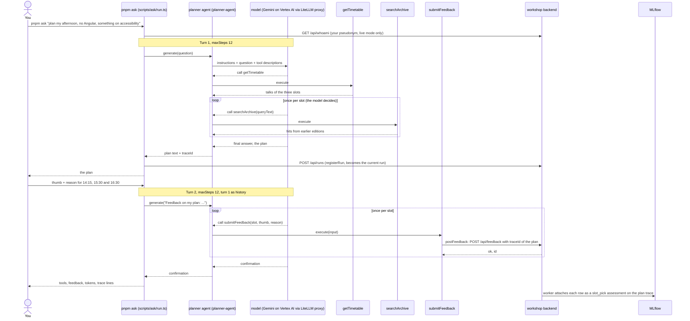
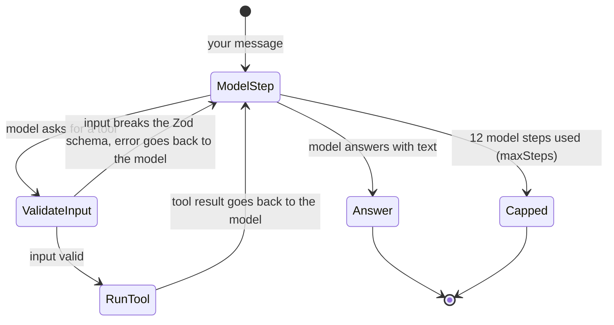
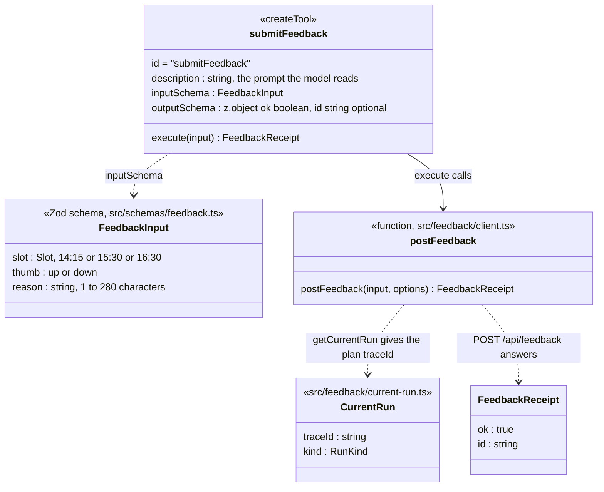
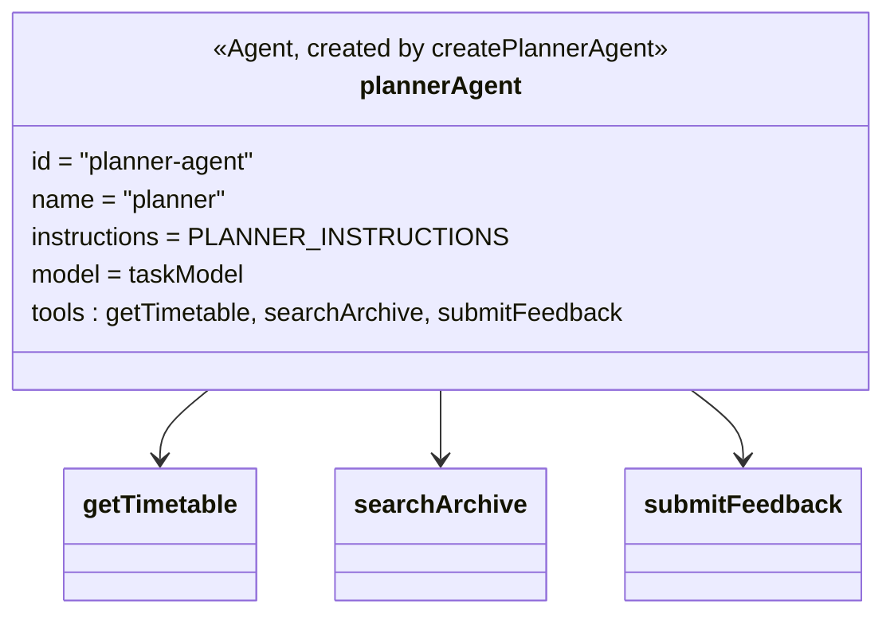

# talk-picker

**Branch `03-start`: Exercise 3, agent with tools plus feedback.** Frontmania
2026, Block 3: 6 minutes theory (11:59), 15 minutes typing (12:05 to 12:20),
5 minutes debrief, then the reveal at 12:25. The general repo material
(setup, privacy, branches, troubleshooting) is
[below the exercise](#about-this-repo).

## Exercise 3: agent with tools plus feedback

### What you build

A **planner agent** with three tools:

| Tool             | File                                  | Who writes it | What it does                                                                    |
| ---------------- | ------------------------------------- | ------------- | ------------------------------------------------------------------------------- |
| `getTimetable`   | `src/mastra/tools/get-timetable.ts`   | given         | lists the Frontmania 2026 talks of one afternoon slot, or of all three          |
| `searchArchive`  | `src/mastra/tools/search-archive.ts`  | given         | finds related recorded talks from earlier editions (vector search)              |
| `submitFeedback` | `src/mastra/tools/submit-feedback.ts` | **you**       | records your verdict (thumb plus reason) on one slot of the plan, once per slot |

From one free-form request such as "plan my afternoon, no Angular, something
on accessibility" the agent plans all three slots (14:15, 15:30, 16:30) in
one answer. You then give a thumb up or down plus a short reason per slot,
and the agent records each verdict through `submitFeedback`. The workshop
backend stores the three rows under your pseudonym and attaches them to
MLflow as `slot_pick` feedback on the trace of your plan. The shape (plan,
research, write) is a scaled-down version of NVIDIA's AI-Q
research-assistant pattern.

### Why

- **Tool calling.** A tool is a typed function the model may call. You do
  not call it; the model asks for it and Mastra runs it.
- **The ReAct loop.** The agent reasons, calls a tool, reads the result and
  repeats until it answers. In exercise 2 you fixed the order of steps in
  code; here the model picks the order at run time, and the trace is the
  only place you can see what it picked. `pnpm ask` caps each turn at 12
  steps (`MAX_AGENT_STEPS` in `scripts/ask/run.ts`).
- **A tool description is a prompt.** The model reads the description to
  decide when and how often to call the tool. "Once per slot" in the
  description is what gets you three rows instead of one.
- **Expectation versus feedback.** Your blind pick at 11:00 is the
  _expectation_: the right answer, given before any advice. Your thumb plus
  reason now is _feedback_: a verdict on one plan the agent showed you,
  given after. The backend attaches both to MLflow traces as different
  assessments: `expected_pick` and `slot_pick`.

### What "done" means

1. `pnpm check:03` passes: it prints your three feedback rows (one per slot,
   with your thumb and reason) on your plan trace and ends with
   `check:03 passed`.
2. You copied the `tools:` line that `pnpm ask` prints into the workbook,
   block 3.

The plan does not have to be good. The agent has to call its tools, plan
three slots and store three verdicts that match what you typed.

### How one `pnpm ask` run works

`pnpm ask` runs two turns with the planner agent. Turn 1 sends your question
and the agent plans; turn 2 sends your three verdicts and the agent calls
`submitFeedback`. The rows attach to the turn-1 trace, because that is the
plan you are judging.



Inside each turn the agent runs the ReAct loop. Every model call is one
step; the cap stops a model that keeps asking for tools.



### Before you start

Coming from exercise 2, park your edits and switch branch:

```bash
git stash
git checkout 03-start
```

`No local changes to save` is fine. No profile is needed: the planner works
only from the question you type, never from your CV. Open
`src/mastra/tools/submit-feedback.ts` and `src/mastra/agents/planner.ts`.

The steps below use the same numbers as the `// TODO(exercise 03, step N)`
markers in the code. Steps 1 and 2 are code steps: `submit-feedback.ts` has
two `step 1` markers (line 1 and the comment above the tool), `planner.ts`
has three `step 2` markers (line 1, above `PLANNER_INSTRUCTIONS` and above
`tools`). Step 3 is a run step and has no marker. Delete every marker when
you are done with its step; `pnpm check:03` fails on any that is left.

### Step 1: define `submitFeedback` (about 4 minutes)

**File:** `src/mastra/tools/submit-feedback.ts`

**Before** (the skeleton on this branch):

```ts
/* eslint-disable @typescript-eslint/no-unused-vars -- TODO(exercise 03, step 1): delete this line when submitFeedback is defined */
// ...imports and doc comment...

// TODO(exercise 03, step 1): define the tool, then delete the eslint-disable line at the top
// of this file (it carries this marker too):
//   ...
export const submitFeedback = createTool({
  id: SUBMIT_FEEDBACK_ID,
  description: '',
  inputSchema: z.object({}),
  outputSchema: z.object({ ok: z.boolean() }),
  execute: async () => ({ ok: false }),
});
```

**After** (as on `03-done`). Delete line 1 and the TODO comment block, then
fill in the four fields. The imports are already at the top of the file:

```ts
export const submitFeedback = createTool({
  id: SUBMIT_FEEDBACK_ID,
  description:
    "Records the user's verdict on one afternoon slot of the plan: thumb up or down and the user's own reason. Call it once per slot the user judged, only after the user gave a verdict, never on your own judgement.",
  inputSchema: FeedbackInput,
  outputSchema: z.object({ ok: z.boolean(), id: z.string().optional() }),
  execute: async (input) => postFeedback(input),
});
```

Instead of reusing `FeedbackInput` (from `src/schemas/feedback.ts`) you may
write the three fields out; then also add
`import { Slot } from '../../schemas/talk.js';`:

```ts
  inputSchema: z.object({
    slot: Slot,
    thumb: z.enum(['up', 'down']),
    reason: z.string().min(1).max(280),
  }),
```

**Why each field:**

- `description` is a prompt: "once per slot" and "only after the user gave
  a verdict" decide how many rows you get and whether the agent ever makes
  one up. The check wants at least 40 characters.
- `inputSchema` is the guard: `Slot` rejects `13:30`, the enum rejects
  `meh`, `.max(280)` rejects an essay. Mastra validates the input before
  `execute` runs and sends a bad call back to the model as an error.
- `execute` gets the validated input as its first argument in the pinned
  `@mastra/core` 1.71.0. Examples on the web that destructure
  `({ context })` are for an older version and store nothing here.
- `postFeedback` (`src/feedback/client.ts`) attaches the verdict to the
  trace of the current run, which `pnpm ask` sets to your plan.



**Check:**

```bash
pnpm check:03 --static
```

Expected after step 1 (the planner lines still fail until step 2):

```text
OK      no exercise marker in src/mastra/tools/submit-feedback.ts
FAIL    no exercise marker in src/mastra/agents/planner.ts: a TODO(exercise 03, step 2) marker remains (step 2)
OK      submitFeedback input schema accepts a verdict
OK      submitFeedback input schema rejects slot 13:30
OK      submitFeedback input schema rejects thumb "meh"
OK      submitFeedback input schema rejects a 281-character reason
OK      submitFeedback description: 209 characters
FAIL    planner tools: planner has 0 tools, expected 3 (step 2)
FAIL    planner instructions: PLANNER_INSTRUCTIONS has 19 characters, expected at least 200 (step 2)
FAIL    mock two-turn ask: feedback rows: 0, expected 3 (step 1 or 2: submitFeedback.execute must call postFeedback and the planner must list it)
OK      static layer: offline, scripted mock planner, feedback kept in memory
check:03 failed: 7 OK, 4 FAIL, 0 BLOCKED (static layer only, <ms> ms)
```

The description count is that of your own text.

### Step 2: give the planner its tools and instructions (about 5 minutes)

**File:** `src/mastra/agents/planner.ts`

**Before:**

```ts
/* eslint-disable @typescript-eslint/no-unused-vars -- TODO(exercise 03, step 2): delete this line when the planner has its three tools */
// ...

// TODO(exercise 03, step 2): write the instructions the planner follows (at least 200 characters):
//   ...
export const PLANNER_INSTRUCTIONS = 'Plan the afternoon.';

// ...inside createPlannerAgent:
    // TODO(exercise 03, step 2): give the planner its three tools, then delete the
    // eslint-disable line at the top of this file (it carries this marker too):
    //   tools: { getTimetable, searchArchive, submitFeedback },
    tools: {},
```

**After, part 1: the tools.** In `createPlannerAgent`, replace `tools: {}`
and delete the TODO comment above it:

```ts
    tools: { getTimetable, searchArchive, submitFeedback },
```

The keys are the tool names the model sees. The imports are already there;
the check wants exactly these three.

**After, part 2: the instructions.** Replace the placeholder and delete the
TODO comment above it. Below is the done branch's text as a worked example.
You may write your own, as long as it makes the agent do these five things
and has at least 200 characters:

1. call `getTimetable` first, and recommend only ids it returned;
2. plan all three slots in one answer;
3. respect the user's constraints, and say so when no talk in a slot fits;
4. call `searchArchive` for one related recording per slot;
5. when the user gives verdicts, call `submitFeedback` once per slot with
   the user's own reason.

```ts
export const PLANNER_INSTRUCTIONS = `You plan the Frontmania 2026 afternoon for one attendee. The afternoon has three slots: 14:15, 15:30 and 16:30.

When asked for a plan:
- Call getTimetable first. Recommend only talks and ids it returned; never invent a talk.
- Plan all three slots in one answer: for each slot one talk with its id, title and one sentence on why it fits.
- Respect every constraint the user states (a technology to avoid, a topic they want). If no talk in a slot fits, say so and name the least bad option.
- For each slot call searchArchive once with the chosen talk's topic and add one related recording from an earlier edition (id and title) as preparation.
- End by asking for a thumb up or down per slot with a short reason.

When the user gives verdicts on the plan:
- Call submitFeedback once per slot they judged, with that slot, their thumb (up or down) and their reason in their own words, shortened to 280 characters if needed.
- Do not call submitFeedback for a slot they did not judge, and never make up a verdict.
- Confirm in one line per slot what you recorded.

Be brief and concrete. No marketing language.`;
```

Finally delete line 1, the `eslint-disable` comment (the third `step 2`
marker).

**Why:** without tools the agent can only guess talks; without "call
getTimetable first" it may recommend a talk that is not in the programme;
without "all three slots in one answer" your three thumbs judge half a plan;
without "their reason in their own words" the stored row may be the model's
paraphrase rather than what you typed.



**Check:**

```bash
pnpm check:03 --static
```

Expected after step 2, all 11 lines OK:

```text
OK      no exercise marker in src/mastra/tools/submit-feedback.ts
OK      no exercise marker in src/mastra/agents/planner.ts
OK      submitFeedback input schema accepts a verdict
OK      submitFeedback input schema rejects slot 13:30
OK      submitFeedback input schema rejects thumb "meh"
OK      submitFeedback input schema rejects a 281-character reason
OK      submitFeedback description: 209 characters
OK      planner tools: getTimetable, searchArchive, submitFeedback
OK      planner instructions: 1108 characters
OK      mock two-turn ask: 3 feedback rows, slots 14:15, 15:30, 16:30
OK      static layer: offline, scripted mock planner, feedback kept in memory
check:03 passed: 11 OK, 0 FAIL, 0 BLOCKED (static layer only, <ms> ms)
```

The static layer runs offline with a scripted mock planner: it proves your
tool and wiring, not your instructions. Only a live run tests those.

### Step 3: ask, judge, check (about 5 minutes)

Run the agent (it calls the model through the proxy):

```bash
pnpm ask "plan my afternoon, no Angular, something on accessibility"
```

Wait for the plan: 10 to 30 seconds, because the agent calls its tools
first. Then the terminal asks per slot, in the order 14:15, 15:30, 16:30:

```text
14:15 thumb (up/down): up
14:15 reason: exactly the gap our design system has between components and pages
15:30 thumb (up/down): down
...
```

Type `up` or `down`, then a short reason about the talk (not about you). A
typo or an empty reason asks the same slot again; the plan is kept. After
turn 2 the agent confirms, and `pnpm ask` prints a summary like this (the
values differ per run):

```text
tools: getTimetable -> searchArchive -> searchArchive -> searchArchive
feedback: 3 of 3 verdicts stored (14:15 up, 15:30 down, 16:30 up)
tokens: <turn 1> + <turn 2> (turn 1 + turn 2)  model calls: <n>  latency: <ms> ms (turn 1)
trace: tr-...  participant: <your id>
saved .talk-picker/last-agent.json
```

Copy the `tools:` line into the workbook, block 3. Yours may show a
different order; that is the point: the model chose it. The `tools:` line
covers turn 1; the three `submitFeedback` calls are in the `feedback:` line.

Then check:

```bash
pnpm check:03
```

It runs the 11 static lines, then reads your last `pnpm ask` and waits up to
20 seconds for the three rows on your plan trace. A
`waiting for MLflow to attach the 3 feedback rows on ...` line may appear
first. When everything holds, the live lines look like this and the check
exits 0:

```text
OK      last agent run: tr-...
OK      feedback rows on your plan trace: 14:15 up "..." | 15:30 down "..." | 16:30 up "..."
OK      feedback attached to MLflow: 3 slot_pick assessments
OK      trace found at the backend: tr-...
OK      tool-call order (trace): getTimetable -> searchArchive -> searchArchive -> searchArchive
check:03 passed: 16 OK, 0 FAIL, 0 BLOCKED (static + live, <ms> ms)
```

Check that the reasons on the `feedback rows` line are yours. Every FAIL
line names the step to look at. After a fix in step 1 or 2, run `pnpm ask`
again before `pnpm check:03`: the check reads your last run.

**Cost.** One `pnpm ask` is at most 24 small-model calls (12 per turn), a few
cents of your key's budget. Run it when you need it; don't loop it.

**No terminal input** (a script, CI): pass the verdicts as a flag, in slot
order, separated by semicolons:
`--feedback "up:reason;down:reason;up:reason"`. Without a terminal and
without the flag, `pnpm ask` refuses to start, before any model call.

### Stuck?

**Stuck for 8 minutes, or still on step 1 at 12:12?** Type:

```bash
git stash
git checkout 03-done
pnpm ask
pnpm check:03
```

Answer the thumb prompts as in step 3; your verdicts on `03-done` count just
the same. Your edits stay in `git stash list`. Nobody checks.

**Step 1 works, step 2 not done at 12:15?** Keep your own tool and take only
the planner from the done branch:

```bash
git checkout 03-done -- src/mastra/agents/planner.ts
pnpm ask
pnpm check:03
```

Then read the done branch's instructions in the editor.

| Symptom                                                                     | Look at                                                                                                                                   |
| --------------------------------------------------------------------------- | ----------------------------------------------------------------------------------------------------------------------------------------- |
| `FAIL no exercise marker ... (step 1)` or `(step 2)` after the code is done | line 1 of the file, the `eslint-disable` comment, carries a marker too; `planner.ts` has three                                            |
| `FAIL mock two-turn ask: feedback rows: 0, expected 3`                      | `execute` must be `async (input) => postFeedback(input)`, not `({ context })`; then the `tools` line in `planner.ts`                      |
| `feedback: 0 of 3 verdicts stored`                                          | the model did not call `submitFeedback`: check its description and the feedback rule in the instructions, then `pnpm ask` again           |
| `feedback rows: 1, expected 3 with distinct slots`                          | the agent made one call for all verdicts or skipped a slot: put "once per slot" in the description and the instructions, `pnpm ask` again |
| the plan names a talk that is not in the programme                          | the agent skipped `getTimetable`: make "call getTimetable first" explicit in the instructions                                             |
| `feedback attached to MLflow` FAIL, not attached within 20 s                | the backend retries every 5 seconds; run `pnpm check:03` again                                                                            |
| `pnpm ask failed: no terminal to ask for verdicts`                          | open a terminal that takes input (the Codespaces terminal does), or pass `--feedback`                                                     |

More symptoms (proxy 401 and 429, backend unreachable, offline mock mode)
are in [When it misbehaves](#when-it-misbehaves).

### Stretch (only after `pnpm check:03` passes)

A second run with a different preference:

```bash
pnpm ask "plan my afternoon, only AI and agents, nothing on CSS"
```

Answer the thumbs, then compare the `tools:` line with your first run (write
it down first, or copy `toolCalls` from `.talk-picker/last-agent.json`). Did
the agent search the archive with different queries? Did it pick the 15:30
workshop, and did it notice that the workshop runs into 16:30? The run
overwrites `.talk-picker/last-agent.json`, so answer all three thumbs if you
want `pnpm check:03` to pass on it again.

---

## About this repo

**Production Agentic AI in TypeScript: Build a Self-Improving Talk Picker with Mastra, MLflow and GEPA**
Frontmania 2026, Jaarbeurs Utrecht, Wednesday 7 October, 11:00 to 12:45.

In 105 minutes you build an agent that reads your CV and picks your Frontmania
talk for 14:15, 15:30 and 16:30, with every step traced and your CV masked;
then you watch the room's feedback rewrite the ranking prompt and you judge,
with the numbers on screen, whether it got better.

| Clock | Segment                                                         | Branch                  |
| ----- | --------------------------------------------------------------- | ----------------------- |
| 11:00 | Welcome, blind pick, Codespace, privacy, demo                   | `00-setup`              |
| 11:12 | Block 1: CV to typed profile (6 theory, 11 exercise, 3 debrief) | `01-start` -> `01-done` |
| 11:32 | Block 2: ranker per slot plus retrieval (7, 14, 4)              | `02-start` -> `02-done` |
| 11:57 | Two-day training and flyer                                      |                         |
| 11:59 | Block 3: agent with tools plus feedback (6, 15, 5)              | `03-start` -> `03-done` |
| 12:25 | Reveal: score before and after, prompt diff, alias move         | `final` (trainer)       |
| 12:37 | Production checklist, closing                                   |                         |

## Start here

1. Open the repo in a Codespace:
   [Open in GitHub Codespaces](https://codespaces.new/Randynamic/frontmania-ai-workshop?quickstart=1)
   (the prebuild has already installed everything). The same URL is on the
   first slide and on your card. Or locally with Node 22: `corepack enable`,
   `pnpm install --frozen-lockfile`, `cp .env.example .env`.
2. Get your `.env` from the key page <https://key-picker-788920378573.europe-west4.run.app> (QR and room code on the first
   slide) and paste it over `.env`, or paste a reserve card's key as `PROXY_API_KEY`. It is the only
   secret you get; it authenticates the model proxy (LiteLLM in front of
   Gemini on Google Vertex AI), trace ingestion and the workshop backend. It
   dies at 13:00.
3. Run `pnpm run doctor`. Every line must say `OK`; the last line prints your
   id, for example `You are otter-42`. (`pnpm doctor` without `run` starts
   pnpm's own built-in doctor, which is not this script.)
4. Open the blind-pick page on your phone (QR on the screen, or
   `<WORKSHOP_BACKEND_URL>/pick`), enter the id and the 8-character pick code
   from your card, and pick one talk per afternoon slot before the demo
   starts. Your picks are final once saved (a second submit answers 409, a
   wrong code 403), so check them before you submit.

## Privacy

- Your CV goes to Google (Vertex AI, region Netherlands) through our proxy to build your profile. We don't store it.
- CV text is masked in traces. We keep your profile and picks under a pseudonym.
- Your `pnpm ask` question, your plan and your feedback reasons also go to Google Vertex AI through our proxy, and stay in the traces until 18:00.
- All workshop data is deleted today at 18:00.
- Prefer not to? Use a sample CV or type your skills.

`pnpm run profile` never writes your CV to disk; traces carry a hash marker
(`[cv:sha256:...]`) where the text was, also when a model echoes only your
name or employer. Those are read from the text itself, markdown or plain: the
capitalised words of its first three lines, every capitalised word that is
not a heading, job title or technology, and, in any letter case, the value
after a `Name:` or `Naam:` label, links and `@handles`, Dutch postcodes and
the word after "at" or "bij" (`src/observability/identity-fields.ts`). A name
you write only in lowercase and without a label is not recognised. See `src/observability/mask.ts` (the processor),
`src/observability/identity-hints.ts` (name, employer and place fragments),
`src/mastra/index.ts` (where it is wired into every trace) and
`src/mastra/index.test.ts` (an agent run whose exported spans carry the
marker and none of the CV). The profile itself has no name, employer or
contact field by schema (exercise 1), and `pnpm run profile` replaces any
name or employer the model echoes inside a value with the same hash marker
before the profile is saved or sent (`src/observability/echo-scrub.ts`).

Using your own CV? Paste it instead of saving it: run
`pnpm run profile --cv -`, paste the text, then press Ctrl-D on an empty line.
Nothing is written to disk. If you do save it as a file, use `private/cv.md`
(`mkdir -p private` first): `private/` is git-ignored, so it cannot be
committed by mistake, and `pnpm run switch` leaves it where it is (a CV
elsewhere in the tree would be stashed away on the next branch change).

In a GitHub Codespace every file, a saved CV included, sits on GitHub
(Microsoft) infrastructure until you delete the Codespace. Who owns it depends
on a setting the trainer chooses: under User ownership (the default for this
workshop) it is owned and paid for by your own GitHub account, Upgraide cannot
open it and our 18:00 deletion cannot reach it; under Organisation ownership
the organisation pays for it and Upgraide deletes it at 18:00. The trainer
says which one applies at the start. Either way, before you leave today:
`rm -rf private/`, then delete the Codespace at <https://github.com/codespaces>
(`...` menu, Delete).

From exercise 3 on we also keep your plan feedback: the thumb and the reason
you type for each slot in `pnpm ask`, under your pseudonym, in the workshop
backend and as `slot_pick` feedback on your plan trace in MLflow. The reason
and your question pass through our proxy to Google Vertex AI, like the plan itself. It
is deleted with everything else at 18:00. Keep reasons about the talks, not
about you.

## Branches

| Command                    | What you get                                                                                   |
| -------------------------- | ---------------------------------------------------------------------------------------------- |
| `pnpm run switch 00-setup` | foundation: Mastra instance with masked tracing, data, infra, shared schemas; no exercise code |
| `pnpm run switch 01-start` | exercise 1 skeleton: Profile schema and profile agent instructions                             |
| `pnpm run switch 01-done`  | exercise 1 solved                                                                              |
| `pnpm run switch 02-start` | exercise 2 skeleton: rankSlot, parallel fan-out, retrieval tip                                 |
| `pnpm run switch 02-done`  | exercise 2 solved                                                                              |
| `pnpm run switch 03-start` | exercise 3 skeleton: submitFeedback tool, planner agent with three tools (you are here)        |
| `pnpm run switch 03-done`  | exercise 3 solved                                                                              |
| `pnpm run switch final`    | 03-done plus the trainer-only optimizer (`optimize/`, Python)                                  |

Each exercise has a done criterion: `pnpm check:01`, `check:02`, `check:03`.
It fails on the start branch with a message that names what is missing and
passes on the done branch.

`pnpm run switch <branch>` keeps your work and changes branch in one go: it
runs `git stash --include-untracked` when you have changes, then
`git checkout <branch>` (a plain `git checkout` refuses to leave a branch whose
exercise files you edited). Your work stays in `git stash list`; `.env`,
`.talk-picker/` and `private/` are git-ignored and stay where they are.

**Stuck for 8 minutes? `pnpm run switch NN-done` and keep going. Nobody checks.**
By hand it is two lines: `git stash --include-untracked`, then `git checkout NN-done`.

## When it misbehaves

| Symptom                            | Fix                                                                                                                                         |
| ---------------------------------- | ------------------------------------------------------------------------------------------------------------------------------------------- |
| proxy 401                          | wrong key: re-paste `PROXY_API_KEY` in `.env`                                                                                               |
| proxy 429                          | you hit the per-key rate cap; wait 10 seconds                                                                                               |
| Zod error from `pnpm run profile`  | the model's answer broke the schema; the message names the field, run it again (structured output is validated, not guaranteed)             |
| trace not found                    | the exporter batches; wait 10 seconds and run the check again                                                                               |
| backend unreachable at `<url>`     | the message names the host and the cause; run the same command with `MODEL_MODE=mock` in front to keep working offline and tell the floater |
| `pnpm plan` says no profile        | run `pnpm run profile` first, or `pnpm plan --profile data/cvs/profiles/<persona>.json`                                                     |
| `pnpm plan` names a wrong talk id  | the ranker answered with an id outside the slot; run it again (the prompt lists the slot's ids, the model still has to copy them)           |
| `pnpm check:02` sequential FAIL    | the three `rankSlot` spans do not overlap: `plan.ts` still says `concurrency: 1`                                                            |
| `pnpm ask` records 0 of 3 verdicts | the planner did not call `submitFeedback`: check its description and the instructions' feedback rule, then run `pnpm ask` again             |
| `pnpm check:03` rows: 1 of 3       | the agent submitted fewer verdicts than slots; run `pnpm ask` again and answer all three thumb prompts                                      |
| `pnpm run doctor` FAIL on data     | ask the floater: the trainer rebuilds the vector index (`pnpm ingest` needs a trainer key); a missing file is `git checkout -- data`        |

## What is deliberately not here

Memory, streaming to the UI, chunking strategies, evals as a safety net,
deployment. Today you build one workflow and see one optimization run. In two
days you build memory, streaming to the UI, chunking strategies and evals as
a safety net, up to production:
[academy.upgraide.nl/frontmania](https://academy.upgraide.nl/frontmania?utm_source=flyer&utm_medium=print&utm_campaign=frontmania-workshop)
(22 to 23 November or 12 to 13 December 2026, EUR 807.50 excl. VAT with the
Frontmania discount, max 20 per session).

## Developer commands

`pnpm typecheck`, `pnpm lint`, `pnpm test`, `pnpm test:coverage`,
`pnpm check:01 --static`, `pnpm check:02 --static`, `pnpm check:03 --static`
(offline, what CI runs);
`MODEL_MODE=mock pnpm plan --profile data/cvs/profiles/<persona>.json` runs
the workflow offline with canned answers, and
`MODEL_MODE=mock pnpm ask --feedback "up:a;down:b;up:c"` runs the agent
offline with a scripted tool loop. Trainer-side:
`pnpm rank-once --profile <json> --slot <slot> [--render-only]` (the
contract-test partner of the optimizer),
`pnpm keys:create`, `pnpm keys:revoke`, `pnpm data:delete`, `pnpm smoke`; the
stack itself is in `infra/` (see `infra/README.md`).
