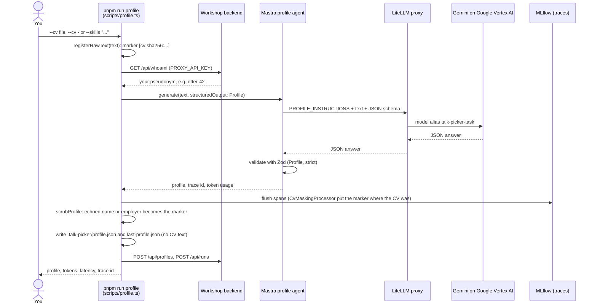
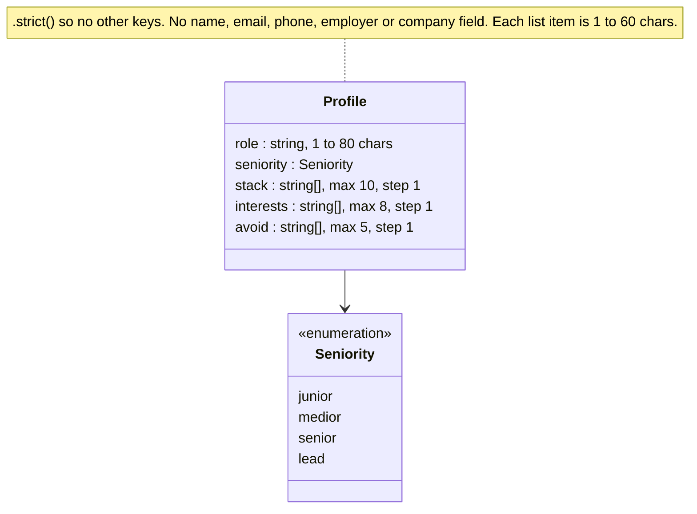
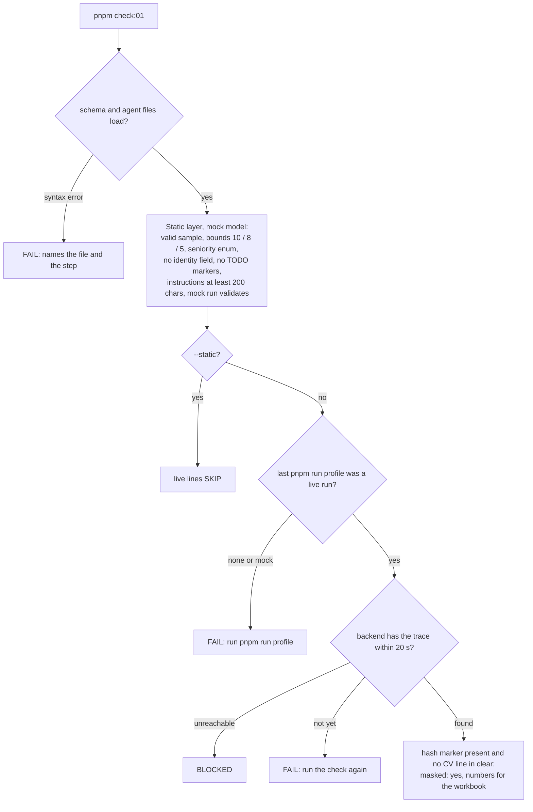

# talk-picker: Exercise 1, CV to typed profile

You are on branch `01-start`. This page first explains the exercise, then
walks you through it step by step. Setup, privacy, branches and
troubleshooting for the whole workshop come after the exercise.

## What you build in this exercise

An **agent that turns a CV, or a typed list of skills, into a typed
`Profile`**: a role, a seniority level, your stack, your interests and the
topics you want to avoid. Every later part of today reads this profile: the
ranker in exercise 2 picks talks for it, the agent in exercise 3 plans from
it, and the room's feedback is scored against it.

You write two things:

1. **The schema** (`src/schemas/profile.ts`): a Zod object that says what a
   valid profile looks like. The model's answer is validated against it, so
   your code gets typed data or an error, never a guess.
2. **The instructions** (`src/mastra/agents/profile.ts`): the text the
   profile agent runs with. For an agent the instructions are the whole
   program: what to extract, how to grade seniority, and what must never
   appear in the output.

**Why it is built this way.** Privacy starts in the schema: a `Profile` has
no field for a name, email, phone, employer or company, so the model has no
place to put them, and `.strict()` rejects any extra key it invents. The
bounds keep a profile a handful of facts instead of the CV in another shape.
The run is traced to MLflow under your pseudonym (for example `otter-42`)
with the CV text replaced by a hash marker `[cv:sha256:...]`, and you read
your own token count and latency from it.

**Done means:**

- `pnpm check:01` passes, with a line `masked: yes (...)`, and
- you wrote **two numbers** in the workbook, block 1: the token count and the
  latency from the `numbers for the workbook` line.

**Time:** 11 minutes of typing, 11:18 to 11:29 (hard stop), then a 3-minute
debrief. At 11:32: `pnpm run switch 02-start`.

> **Stuck for 8 minutes, or still on step 1 at 11:26?** Type `git stash`,
> then `git checkout 01-done` (or in one go: `pnpm run switch 01-done`). Then
> do step 3 there and write the numbers. Nobody checks; the profile from the
> done branch is just as good.

### How `pnpm run profile` works

What happens when you run step 3. Your two edits are the `Profile` schema
and the `PROFILE_INSTRUCTIONS`; everything else is already in the repo.



You never configure Google: the proxy holds the Vertex AI access, and your
`PROXY_API_KEY` in `.env` authenticates you to the proxy, the trace
endpoint and the backend.

### The `Profile` you complete



## Step by step

Steps 1 and 2 match the `// TODO(exercise 01, step N)` markers in the code
(step 1: three markers in the schema, step 2: one marker in the agent).
Step 3 is commands only, so it has no marker.

### Step 1: bound the arrays in the `Profile` schema

**File:** `src/schemas/profile.ts`

**Before** (what you find on `01-start`):

```ts
    /** Technologies actually used, most recent first. */
    // TODO(exercise 01, step 1): bound to MAX_STACK items with .max(...)
    stack: z.array(Item),
    /** Topics the person wants to see talks about. */
    // TODO(exercise 01, step 1): bound to MAX_INTERESTS items
    interests: z.array(Item),
    /** Topics the person does not want; the ranker treats these as hard filters. */
    // TODO(exercise 01, step 1): bound to MAX_AVOID items
    avoid: z.array(Item),
```

**After** (add `.max(...)` to each array and delete the three `TODO` lines):

```ts
    /** Technologies actually used, most recent first. */
    stack: z.array(Item).max(MAX_STACK),
    /** Topics the person wants to see talks about. */
    interests: z.array(Item).max(MAX_INTERESTS),
    /** Topics the person does not want; the ranker treats these as hard filters. */
    avoid: z.array(Item).max(MAX_AVOID),
```

`MAX_STACK` (10), `MAX_INTERESTS` (8), `MAX_AVOID` (5) and `Item` (a string
of 1 to 60 characters) are already defined at the top of the file; the
literals `10`, `8` and `5` pass too. Leave `.strict()` at the end of the
object and do not add a `name`, `email`, `phone`, `employer` or `company`
field.

**Why:** the bounds keep every later prompt small and predictable, and a
model that overshoots now fails loudly with a Zod error instead of silently
stuffing the ranker. The missing identity fields are the first privacy
layer: the model cannot output what the schema has no room for.

**Check it** (offline, no key needed):

```bash
pnpm check:01 --static
```

The four step-1 lines now say `OK`:

```text
OK      stack bounded: max 10
OK      interests bounded: max 8
OK      avoid bounded: max 5
OK      no exercise marker in src/schemas/profile.ts
```

The step-2 lines still fail until you finish step 2; that is expected.

### Step 2: write `PROFILE_INSTRUCTIONS`

**File:** `src/mastra/agents/profile.ts`

**Before:**

```ts
// TODO(exercise 01, step 2): write the instructions. Cover: what to extract (role,
// seniority on the four-level scale with a rule for when years are not stated,
// stack, interests, topics to avoid); never output names, employers or contact
// details; vague input yields shorter arrays and a lower seniority, not guesses.
export const PROFILE_INSTRUCTIONS = `Extract a profile from the text.`;
```

**After** (the text on `01-done`; type it, or write your own with the same
five parts; delete the four `TODO` comment lines):

```ts
export const PROFILE_INSTRUCTIONS = `You turn a CV, or a typed list of skills, into a conference-attendee profile.
The profile picks afternoon talks for this person; it is not a summary of the CV.

Extract exactly these fields:
- role: what the person does, in one short phrase (under 80 characters), without any employer or product name
  (for example "front-end architect at a logistics scale-up", "junior Angular developer in government").
- seniority: one of junior, medior, senior, lead.
  When years of experience are stated: under 2 years is junior, 2 to 5 is medior, 5 to 10 is senior,
  more than 10 is senior unless the person owns a team, a platform or an architecture, which is lead.
  When years are not stated: owning a team or the architecture is lead, leading projects or mentoring
  others is senior, a first job or a study is junior, everything else is medior. In doubt, pick the lower level.
- stack: up to 10 technologies the person actually uses, most recent first. Skip tools mentioned once in passing.
- interests: up to 8 topics the person would want to see a talk about, taken from what they build and what they say they want to learn.
- avoid: up to 5 topics the person does not want; only what the text says or clearly implies, never a guess.

Rules:
- Never output names, employers, clients, cities, email addresses, phone numbers, links or anything else that identifies the person.
- Vague or short input gives shorter arrays and a lower seniority, never invented details.
- Write every value in English, even when the input is Dutch. Keep each array item short (one to four words).
- Answer only with the requested structure.`;
```

The five parts and why each is there:

| Part                           | Why                                                                                                                       |
| ------------------------------ | ------------------------------------------------------------------------------------------------------------------------- |
| The job (first two lines)      | a profile for picking talks, not a summary; without it the model pads `interests` with the whole skills list              |
| Fields with the seniority rule | without a rule with numbers the model copies "Principal" or "Senior" from a job title instead of reading the years        |
| Never output identity          | `role` is a free string, so the schema alone cannot stop "developer at Hexaloop"; the instruction is the guard for values |
| Vague input, lower level       | a short `--skills` line then gives a short, honest profile instead of a confident one                                     |
| Output rule                    | English values, short items, only the structure: what the ranker in exercise 2 expects                                    |

**Two traps.** The text is one template literal (between backticks), so it
must contain **no backtick and no `${`**; coding assistants like to write
`` `junior` ``, which makes the file fail to load. And the check wants at
least 200 characters and no `TODO` in the text.

**Why:** the schema decides the shape, the instructions decide the content.
`pnpm check:01` can prove the shape; only good instructions make the
content right.

**Check it:**

```bash
pnpm check:01 --static
```

All static lines now say `OK` (the character count is that of your text):

```text
OK      Profile parses a valid sample
OK      stack bounded: max 10
OK      interests bounded: max 8
OK      avoid bounded: max 5
OK      seniority is the four-level enum
OK      no identity field
OK      no exercise marker in src/schemas/profile.ts
OK      no exercise marker in src/mastra/agents/profile.ts
OK      profile agent instructions: 1618 characters
OK      mock run yields a valid Profile
OK      static layer: offline, mock model
SKIP    masked: live layer; run `pnpm check:01` without --static after `pnpm run profile`
SKIP    numbers for the workbook: live layer; tokens and latency come from your traced run
check:01 passed: 11 OK, 0 FAIL, 0 BLOCKED, 2 SKIP (static layer only, <ms> ms)
```

### Step 3: run the agent and check

Run **one** of these (with `run`: plain `pnpm profile` is a pnpm builtin):

```bash
pnpm run profile --cv data/cvs/02-senior-react-architect.md   # a fictional sample CV
pnpm run profile --cv -        # your own CV: paste it, then Ctrl-D on an empty line; nothing is saved
pnpm run profile --skills "what you do, what you want to see, what you want to avoid"
```

Expected output (the labels are fixed, the values differ per run; this is an
example):

```text
role        front-end architect at a logistics scale-up
seniority   lead
stack       TypeScript, React, Next.js, Node.js, Zod, tRPC, Tailwind, Playwright, OpenTelemetry, Turborepo
interests   human-in-the-loop agent UX, observability and tracing for LLM features, evaluation and cost per request
avoid       Angular deep dives, vendor keynotes, Python notebooks

tokens: 1412  latency: 3184 ms
trace: tr-3f9c1e7a...  participant: otter-42
saved .talk-picker/profile.json and .talk-picker/last-profile.json (no CV text)
```

Then:

```bash
pnpm check:01
```

It runs the static lines from step 2 again, then the live layer. A
`waiting for trace ...` line may appear once or twice first (the exporter
batches). When everything holds, it ends like this:

```text
OK      last profile validates
OK      trace found at the backend: tr-3f9c1e7a...
OK      hash marker in trace: [cv:sha256:...]
OK      masked: yes (... CV lines checked)
OK      numbers for the workbook: tokens: 1412  latency: 3184 ms
check:01 passed: 16 OK, 0 FAIL, 0 BLOCKED (static + live, <ms> ms)
```

With `--skills` the masked line reads `masked: yes (typed skills, marker
only)`, with `--cv -` it reads `masked: yes (pasted CV, not on disk, marker
only)`; both are a pass.

**Write the two numbers** from the `numbers for the workbook` line into the
workbook, block 1. If that line says `n/a`, copy the `tokens: ... latency:
... ms` line that `pnpm run profile` printed; if that says `n/a` too, write
`n/a` and take the trainer's numbers in the debrief. You are done.

**Why:** the static layer proves your two edits; the live layer proves the
run reached MLflow under your pseudonym with the CV masked. The numbers are
the first "cost and latency per step" you will multiply in the debrief.

### How the check decides



Exit code 0 means every line is `OK` (or `SKIP` with `--static`), 1 means at
least one `FAIL`, 2 means no `FAIL` but the live layer was `BLOCKED`. Every
`FAIL` line ends with the step to look at, for example:

```text
FAIL    stack bounded: stack accepts 11 items, expected .max(10) (step 1)
FAIL    profile agent instructions: PROFILE_INSTRUCTIONS has 32 characters, expected at least 200 (step 2)
```

### If a step goes wrong

| You see                                                         | Do this                                                                                                                                   |
| --------------------------------------------------------------- | ----------------------------------------------------------------------------------------------------------------------------------------- |
| `ERR_PNPM_NOT_IMPLEMENTED` or pnpm's own doctor output          | you typed `pnpm profile` or `pnpm doctor`; use `pnpm run profile` and `pnpm run doctor`                                                   |
| `syntax error in src/mastra/agents/profile.ts`                  | a backtick or `${` inside `PROFILE_INSTRUCTIONS`; remove it (step 2)                                                                      |
| `PROFILE_INSTRUCTIONS has 87 characters, expected at least 200` | add the seniority rule with numbers and the never-output-names rule                                                                       |
| Zod error from `pnpm run profile`                               | the model overshot the schema; run it again (structured output is validated, not guaranteed). Twice? Write "up to 10" in the instructions |
| `trace found at the backend: ... not ingested within 20 s`      | run `pnpm check:01` again; still missing, run `pnpm run doctor` and look at the `tracing` line                                            |
| `last run was a mock run`                                       | run `pnpm run profile` again without `MODEL_MODE=mock`, then the check                                                                    |
| `BLOCKED` on the trace line                                     | the backend is unreachable (the room's problem, not yours); tell the floater                                                              |

Proxy or backend down for the whole room? Run offline:
`MODEL_MODE=mock pnpm run profile --cv data/cvs/02-senior-react-architect.md`
and `pnpm check:01 --static`. The mock ignores your CV and instructions and
returns one canned profile; its numbers are marked `(mock, not for the
workbook)`, so take the trainer's numbers in the debrief. Afterwards run
`pnpm run profile` once more without `MODEL_MODE=mock`, because the mock run
overwrote `.talk-picker/profile.json` with the canned profile.

Examples in your instructions must be invented, never a real CV: the
instruction text itself is not masked in the traces.

### Stretch (only after `pnpm check:01` passes)

Both stretches need a live run; the mock model returns one canned profile.

1. **Confidence per field.** Add an optional object to `Profile`, before
   `.strict()`, and one line in the instructions telling the agent to fill
   it. This is the version on `01-done`:

   ```ts
   const MIN_CONFIDENCE = 0;
   const MAX_CONFIDENCE = 1;
   const Confidence = z.number().min(MIN_CONFIDENCE).max(MAX_CONFIDENCE);

   export const ProfileConfidence = z
     .object({
       role: Confidence,
       seniority: Confidence,
       stack: Confidence,
       interests: Confidence,
       avoid: Confidence,
     })
     .partial();

   // inside z.object({ ... }) of Profile, after avoid:
   //   confidence: ProfileConfidence.optional(),
   ```

   Both `.partial()` and `.optional()` matter: without `.optional()` every
   profile without the field fails, and `check:01` says
   `confidence is required; add .optional()`. `pnpm run profile` prints the
   extra field as JSON. Compare the values for the sample CV with a short
   `--skills` run.

2. **Make `avoid` explicit.** Add one invented example to the instructions
   (a CV that says "no Python notebooks" yields `avoid: ["Python notebooks"]`;
   a CV that never mentions Python yields nothing about Python). Run
   `--cv data/cvs/01-junior-angular-gov.md` and check that `avoid` holds
   exactly the three topics that CV names.

---

## About this workshop

**Production Agentic AI in TypeScript: Build a Self-Improving Talk Picker with Mastra, MLflow and GEPA**
Frontmania 2026, Jaarbeurs Utrecht, Wednesday 7 October, 11:00 to 12:45.

In 105 minutes you build an agent that reads your CV and picks your Frontmania
talk for 14:15, 15:30 and 16:30, with every step traced and your CV masked;
then you watch the room's feedback rewrite the ranking prompt and you judge,
with the numbers on screen, whether it got better.

| Clock | Segment                                                         | Branch                  |
| ----- | --------------------------------------------------------------- | ----------------------- |
| 11:00 | Welcome, blind pick, Codespace, privacy, demo                   | `00-setup`              |
| 11:12 | Block 1: CV to typed profile (6 theory, 11 exercise, 3 debrief) | `01-start` -> `01-done` |
| 11:32 | Block 2: ranker per slot plus retrieval (7, 14, 4)              | `02-start` -> `02-done` |
| 11:57 | Two-day training and flyer                                      |                         |
| 11:59 | Block 3: agent with tools plus feedback (6, 15, 5)              | `03-start` -> `03-done` |
| 12:25 | Reveal: score before and after, prompt diff, alias move         | `final` (trainer)       |
| 12:37 | Production checklist, closing                                   |                         |

## Start here

1. Open the repo in a Codespace:
   [Open in GitHub Codespaces](https://codespaces.new/Randynamic/frontmania-ai-workshop?quickstart=1)
   (the prebuild has already installed everything). The same URL is on the
   first slide and on your card. Or locally with Node 22: `corepack enable`,
   `pnpm install --frozen-lockfile`, `cp .env.example .env`.
2. Get your `.env` from the key page <https://key-picker-788920378573.europe-west4.run.app> (QR and room code on the first
   slide) and paste it over `.env`, or paste a reserve card's key as `PROXY_API_KEY`. It is the only
   secret you get; it authenticates the model proxy, trace ingestion and the
   workshop backend. It dies at 13:00.
3. Run `pnpm run doctor`. Every line must say `OK`; the last line prints your
   id, for example `You are otter-42`. (`pnpm doctor` without `run` starts
   pnpm's own built-in doctor, which is not this script.)
4. Open the blind-pick page on your phone (QR on the screen, or
   `<WORKSHOP_BACKEND_URL>/pick`), enter the id and the 8-character pick code
   from your card, and pick one talk per afternoon slot before the demo
   starts. Your picks are final once saved (a second submit answers 409, a
   wrong code 403), so check them before you submit.

## Privacy

- Your CV goes to Google (Vertex AI, region Netherlands) through our proxy to build your profile. We don't store it.
- CV text is masked in traces. We keep your profile and picks under a pseudonym.
- Your `pnpm ask` question, your plan and your feedback reasons also go to Google Vertex AI through our proxy, and stay in the traces until 18:00.
- All workshop data is deleted today at 18:00.
- Prefer not to? Use a sample CV or type your skills.

`pnpm run profile` never writes your CV to disk; traces carry a hash marker
(`[cv:sha256:...]`) where the text was, also when a model echoes only your
name or employer. Those are read from the text itself, markdown or plain: the
capitalised words of its first three lines, every capitalised word that is
not a heading, job title or technology, and, in any letter case, the value
after a `Name:` or `Naam:` label, links and `@handles`, Dutch postcodes and
the word after "at" or "bij" (`src/observability/identity-fields.ts`). A name
you write only in lowercase and without a label is not recognised. See `src/observability/mask.ts` (the processor),
`src/observability/identity-hints.ts` (name, employer and place fragments),
`src/mastra/index.ts` (where it is wired into every trace) and
`src/mastra/index.test.ts` (an agent run whose exported spans carry the
marker and none of the CV). The profile itself has no name, employer or
contact field by schema (exercise 1), and `pnpm run profile` replaces any
name or employer the model echoes inside a value with the same hash marker
before the profile is saved or sent (`src/observability/echo-scrub.ts`).

Using your own CV? Paste it instead of saving it: run
`pnpm run profile --cv -`, paste the text, then press Ctrl-D on an empty line.
Nothing is written to disk. If you do save it as a file, use `private/cv.md`
(`mkdir -p private` first): `private/` is git-ignored, so it cannot be
committed by mistake, and `pnpm run switch` leaves it where it is (a CV
elsewhere in the tree would be stashed away on the next branch change).

In a GitHub Codespace every file, a saved CV included, sits on GitHub
(Microsoft) infrastructure until you delete the Codespace. Who owns it depends
on a setting the trainer chooses: under User ownership (the default for this
workshop) it is owned and paid for by your own GitHub account, Upgraide cannot
open it and our 18:00 deletion cannot reach it; under Organisation ownership
the organisation pays for it and Upgraide deletes it at 18:00. The trainer
says which one applies at the start. Either way, before you leave today:
`rm -rf private/`, then delete the Codespace at <https://github.com/codespaces>
(`...` menu, Delete).

## Branches

| Command                    | What you get                                                                                   |
| -------------------------- | ---------------------------------------------------------------------------------------------- |
| `pnpm run switch 00-setup` | foundation: Mastra instance with masked tracing, data, infra, shared schemas; no exercise code |
| `pnpm run switch 01-start` | exercise 1 skeleton: Profile schema and profile agent instructions (you are here)              |
| `pnpm run switch 01-done`  | exercise 1 solved                                                                              |
| `pnpm run switch 02-start` | exercise 2 skeleton: rankSlot, parallel fan-out, retrieval tip                                 |
| `pnpm run switch 02-done`  | exercise 2 solved                                                                              |
| `pnpm run switch 03-start` | exercise 3 skeleton: submitFeedback tool, planner agent with three tools                       |
| `pnpm run switch 03-done`  | exercise 3 solved                                                                              |
| `pnpm run switch final`    | 03-done plus the trainer-only optimizer (`optimize/`, Python)                                  |

Each exercise has a done criterion: `pnpm check:01`, `check:02`, `check:03`.
It fails on the start branch with a message that names what is missing and
passes on the done branch.

`pnpm run switch <branch>` keeps your work and changes branch in one go: it
runs `git stash --include-untracked` when you have changes, then
`git checkout <branch>` (a plain `git checkout` refuses to leave a branch whose
exercise files you edited). Your work stays in `git stash list`; `.env`,
`.talk-picker/` and `private/` are git-ignored and stay where they are.

**Stuck for 8 minutes? `pnpm run switch NN-done` and keep going. Nobody checks.**
By hand it is two lines: `git stash --include-untracked`, then `git checkout NN-done`.

## When it misbehaves

| Symptom                           | Fix                                                                                                                                         |
| --------------------------------- | ------------------------------------------------------------------------------------------------------------------------------------------- |
| proxy 401                         | wrong key: re-paste `PROXY_API_KEY` in `.env`                                                                                               |
| proxy 429                         | you hit the per-key rate cap; wait 10 seconds                                                                                               |
| Zod error from `pnpm run profile` | the model's answer broke the schema; the message names the field, run it again (structured output is validated, not guaranteed)             |
| trace not found                   | the exporter batches; wait 10 seconds and run the check again                                                                               |
| backend unreachable at `<url>`    | the message names the host and the cause; run the same command with `MODEL_MODE=mock` in front to keep working offline and tell the floater |
| `pnpm plan` says no profile       | run `pnpm run profile` first, or `--profile data/cvs/profiles/<persona>.json`                                                               |
| `pnpm run doctor` FAIL on data    | ask the floater: the trainer rebuilds the vector index (`pnpm ingest` needs a trainer key); a missing file is `git checkout -- data`        |

## When it misbehaves

| Symptom                           | Fix                                                                                                                                         |
| --------------------------------- | ------------------------------------------------------------------------------------------------------------------------------------------- |
| proxy 401                         | wrong key: re-paste `PROXY_API_KEY` in `.env`                                                                                               |
| proxy 429                         | you hit the per-key rate cap; wait 10 seconds                                                                                               |
| Zod error from `pnpm run profile` | the model's answer broke the schema; the message names the field, run it again (structured output is validated, not guaranteed)             |
| trace not found                   | the exporter batches; wait 10 seconds and run the check again                                                                               |
| backend unreachable at `<url>`    | the message names the host and the cause; run the same command with `MODEL_MODE=mock` in front to keep working offline and tell the floater |
| `pnpm plan` says no profile       | run `pnpm run profile` first, or `--profile data/cvs/profiles/<persona>.json`                                                               |
| `pnpm run doctor` FAIL on data    | ask the floater: the trainer rebuilds the vector index (`pnpm ingest` needs a trainer key); a missing file is `git checkout -- data`        |

## What is deliberately not here

Memory, streaming to the UI, chunking strategies, evals as a safety net,
deployment. Today you build one workflow and see one optimization run. In two
days you build memory, streaming to the UI, chunking strategies and evals as
a safety net, up to production:
[academy.upgraide.nl/frontmania](https://academy.upgraide.nl/frontmania?utm_source=flyer&utm_medium=print&utm_campaign=frontmania-workshop)
(22 to 23 November or 12 to 13 December 2026, EUR 807.50 excl. VAT with the
Frontmania discount, max 20 per session).

## Developer commands

`pnpm typecheck`, `pnpm lint`, `pnpm test`, `pnpm test:coverage`,
`pnpm check:01 --static` (offline, what CI runs). Trainer-side:
`pnpm keys:create`, `pnpm keys:revoke`, `pnpm data:delete`, `pnpm smoke`; the
stack itself is in `infra/` (see `infra/README.md`).
