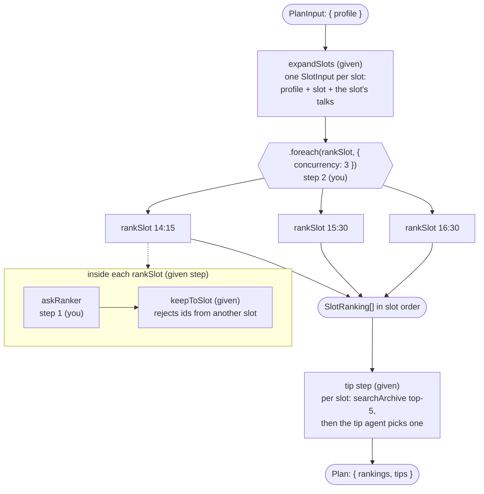
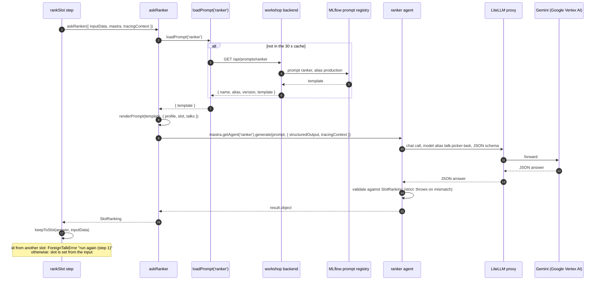
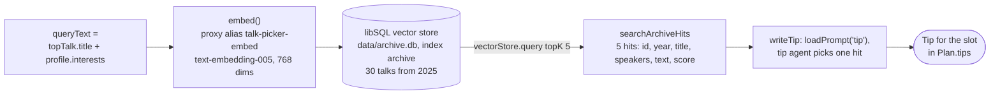

# talk-picker

**Production Agentic AI in TypeScript: Build a Self-Improving Talk Picker with Mastra, MLflow and GEPA**
Frontmania 2026, Jaarbeurs Utrecht, Wednesday 7 October, 11:00 to 12:45.

You are on branch `02-start`. This page starts with the exercise. The general
material (setup, privacy, branches, troubleshooting) follows
[after the exercise](#the-workshop).

# Exercise 2: ranker per slot plus retrieval

14 minutes of typing, 11:39 to 11:53. At 11:59 you run
`pnpm run switch 03-start`.

## What you build

A Mastra workflow called `plan`. It takes your profile from exercise 1 and
returns your afternoon:

- For each afternoon slot (14:15, 15:30, 16:30) it asks the **ranker agent**
  to rank that slot's talks for you. The ranker prompt is not in the code. It
  comes from the **MLflow prompt registry**, prompt `ranker`, alias
  `production`.
- The three slots are ranked **in parallel**, three model calls at the same
  time.
- A given **tip step** then does **vector retrieval** over the 2025 archive:
  per slot it finds the five archive talks closest to your top pick and lets
  the tip agent choose one recorded talk to watch.

You write two things: the body of `askRanker` (step 1) and the parallel
fan-out (step 2). Retrieval is already written; in step 3 you run it, read
it and measure it.

## Why

- **Prompt from the registry.** At 12:25 GEPA has rewritten the ranker
  prompt from the room's feedback. Moving the `production` alias changes your
  ranking without a code change or a deploy. That only works if the code
  loads the prompt by alias instead of holding the text.
- **Parallel slots.** The three slots do not depend on each other. Run them
  together and you wait for the slowest call instead of all three in a row,
  for the same tokens.
- **Retrieval versus in-prompt.** The archive could also go into the prompt
  whole. `pnpm compare` measures both, so you decide with your own token and
  latency numbers, not with fashion.

## Done means

1. `pnpm check:02` passes (exit code 0). The last line reads
   `check:02 passed: 19 OK, 0 FAIL, 0 BLOCKED (static + live, <ms> ms)`.
   18 OK plus one `WARN last compare run` also passes; it only means
   `pnpm compare` has not run yet.
2. In the workbook, block 2: the **three top-pick ids** from the
   `top picks:` line of your last `pnpm plan`, and the **two token/latency
   pairs** (`in-prompt` and `retrieval`) from `pnpm compare`.

The plan does not have to be good. It has to validate, rank in parallel and
carry three tips.

**Stuck for 8 minutes, or still on step 1 at 11:47?** Type:

```sh
pnpm run switch 02-done
pnpm plan
```

No `.talk-picker/profile.json` from block 1? Then that `pnpm plan` needs the
flag too: `pnpm plan --profile data/cvs/profiles/<persona>.json`. Write the
three ids, then run `pnpm compare` and `pnpm check:02` as in step 3. Your
edits stay in `git stash list`. Nobody checks.

## The workflow you are completing

`src/mastra/workflows/plan.ts` wires four pieces. The ones marked "you" are
the two steps you type.



| Name in the code | File                                         | Role                                                           |
| ---------------- | -------------------------------------------- | -------------------------------------------------------------- |
| `planWorkflow`   | `src/mastra/workflows/plan.ts`               | the workflow, id `plan`                                        |
| `expandSlots`    | `src/mastra/workflows/steps/expand-slots.ts` | one `SlotInput` per slot (given)                               |
| `rankSlot`       | `src/mastra/workflows/steps/rank-slot.ts`    | calls `askRanker`, then `keepToSlot` (given)                   |
| `askRanker`      | `src/mastra/workflows/steps/rank-slot.ts`    | **step 1**: one ranker call for one slot                       |
| `tipStep`        | `src/mastra/workflows/steps/tip.ts`          | step id `tip`: retrieval plus one tip per slot (given, step 3) |

## Step 1: rank one slot (`askRanker`)

**File:** `src/mastra/workflows/steps/rank-slot.ts`. Marker:
`TODO(exercise 02, step 1)`, which appears **twice**: on line 1 and inside
`askRanker`.

**Before** (what is on the branch now):

```ts
/* eslint-disable @typescript-eslint/no-unused-vars -- TODO(exercise 02, step 1): delete this line when askRanker is written */
// ...imports...

export const askRanker = async ({
  inputData,
  mastra,
  tracingContext,
}: AskRankerParams): Promise<SlotRanking> => {
  // TODO(exercise 02, step 1): rank this slot. Replace the throw with these lines,
  // then delete the eslint-disable line at the top of this file (it carries this marker too):
  //   const { profile, slot, talks } = inputData;
  //   ...
  throw new Error('askRanker is not implemented yet (exercise 02, step 1)');
};
```

**What to do:**

1. Delete line 1 (the `eslint-disable` comment). Once your code uses the
   imports, it has no reason to exist, and it carries the step 1 marker.
2. Inside `askRanker`, delete the whole comment block and the `throw`.
3. Type the five statements below in their place.

**After:**

```ts
export const askRanker = async ({
  inputData,
  mastra,
  tracingContext,
}: AskRankerParams): Promise<SlotRanking> => {
  const { profile, slot, talks } = inputData;
  const { template } = await loadPrompt('ranker');
  const prompt = renderPrompt(template, {
    profile: serializeProfile(profile),
    slot,
    talks: serializeTalks(talks),
  });
  const result = await mastra.getAgent('ranker').generate(prompt, {
    structuredOutput: { schema: SlotRanking, errorStrategy: 'strict' },
    tracingContext,
  });
  return result.object;
};
```

All the imports (`loadPrompt`, `renderPrompt`, `serializeProfile`,
`serializeTalks`, `SlotRanking`) are already at the top of the file.

**Why each line:**

| Line                                 | Why                                                                                                                                                    |
| ------------------------------------ | ------------------------------------------------------------------------------------------------------------------------------------------------------ |
| `inputData`                          | One `SlotInput` from `expandSlots`: your profile, this slot, this slot's talks.                                                                        |
| `loadPrompt('ranker')`               | Fetches the prompt from the registry by alias `production` (cached 30 s). Moving the alias changes the ranking without a deploy.                       |
| `serializeProfile`, `serializeTalks` | Turn objects into the exact strings the Python optimizer renders too, so GEPA optimises the prompt the code actually sends.                            |
| `renderPrompt`                       | Fills the `{{profile}}`, `{{slot}}` and `{{talks}}` placeholders; it throws if one is missing.                                                         |
| `errorStrategy: 'strict'`            | An answer that does not match the `SlotRanking` Zod schema fails the step with a message, instead of travelling on quietly.                            |
| `tracingContext`                     | Nests the model call under the workflow trace. Without it each ranker call starts its own trace and the check cannot tie the three calls to your plan. |

One `askRanker` call, end to end:



With `MODEL_MODE=mock`, `loadPrompt` returns the seed template from
`src/prompts/seed.ts` and the agent answers with a canned reply; nothing
leaves your machine.

**Run it:**

```sh
pnpm plan
```

Each slot prints a ranking, a `why:` and a `tip:` line (the tip step is
already in place). The values vary per run; the labels do not:

```text
14:15  (confidence 0.82)
    1. [fm26-1227996] Human-in-the-Loop Beyond Approval: Toward True Collaboration
    2. [fm26-1223815] Git Worktrees: One Repo, N Coding Agents
    ...
  why: <one sentence from the ranker>
  tip: [fm25-...] <one sentence from the tip agent>

15:30  (confidence ...)
...

top picks: 14:15 fm26-... | 15:30 fm26-... | 16:30 fm26-...
tokens: <n>  latency: <ms> ms
trace: tr-...  participant: <your id>  profile: .talk-picker/profile.json
saved .talk-picker/last-plan.json
```

Write the latency in the workbook margin as **sequential**: the three slots
still run one after another.

## Step 2: rank the three slots in parallel

**File:** `src/mastra/workflows/plan.ts`. Marker:
`TODO(exercise 02, step 2)`.

**Before:**

```ts
  .then(expandSlots)
  // TODO(exercise 02, step 2): rank the three slots in parallel: concurrency 3, not 1.
  .foreach(rankSlot, { concurrency: 1 })
  .then(tipStep)
  .commit();
```

**What to do:** delete the marker line and change `1` to `3`.

**After:**

```ts
  .then(expandSlots)
  .foreach(rankSlot, { concurrency: 3 })
  .then(tipStep)
  .commit();
```

(`02-done` writes `{ concurrency: RANK_CONCURRENCY }`, the constant declared
above it with the value 3. Either passes the check.)

**Why:** `.foreach` runs `rankSlot` once per item of the array that
`expandSlots` returned. `concurrency` is how many run at the same time. The
slots do not depend on each other, so 3 costs the same tokens and you wait
for the slowest call only.

Run `pnpm plan` again and write the latency as **parallel**. The tokens stay
about the same; the latency drops. It does not drop to a third: the timeline
below shows why.

```mermaid
gantt
    title pnpm plan offline, MOCK_LATENCY_MS=800 (measured 4989 ms vs 3382 ms)
    dateFormat x
    axisFormat %S.%L s
    section concurrency 1
    rankSlot 14.15        :s1, 0, 800
    rankSlot 15.30        :s2, 800, 1600
    rankSlot 16.30        :s3, 1600, 2400
    tip step, 3 tips      :s4, 2400, 4800
    section concurrency 3
    rankSlot 14.15        :p1, 0, 800
    rankSlot 15.30        :p2, 0, 800
    rankSlot 16.30        :p3, 0, 800
    tip step, 3 tips      :p4, 800, 3200
```



No proxy? `MODEL_MODE=mock MOCK_LATENCY_MS=800 pnpm plan` gives every mock
model call 800 ms, so the speed-up shows offline too (mock numbers do not go
in the workbook).

## Step 3: run retrieval, compare, check

There is **no code to type** in step 3 and no step 3 marker: retrieval in
`src/mastra/workflows/steps/tip.ts` is given. Read it so you know what you
are measuring.

The given loop in `tipStep`:

```ts
for (const ranking of inputData) {
  const topTalk = topTalkFor(ranking);
  const hits = searchArchiveHits(
    await searchArchive.execute(
      { queryText: `${topTalk.title} ${profile.interests.join(' ')}`, topK: 5 },
      { mastra },
    ),
  );
  const tip = await writeTip(ranking, hits, profile, { mastra, tracingContext });
  if (tip) tips.push(tip);
}
```

- **The query** is your top talk's title plus your interests, so the tip
  prepares you for the talk you will see, in the direction you care about.
- **`searchArchive`** (`src/mastra/tools/search-archive.ts`) embeds that
  text and asks the libSQL vector store for the 5 nearest rows:

  ```ts
  const { embedding } = await embed({ model, value: input.queryText });
  const results = await vectorStore.query({
    indexName: ARCHIVE_INDEX,
    queryVector: embedding,
    topK: input.topK,
    ...(filter ? { filter: filter as VectorFilter } : {}),
  });
  ```

- **`searchArchiveHits`** turns the tool's result into typed hits, or a
  readable error.
- **`writeTip`** sends the hits to the tip agent, with the registry prompt
  `tip`. The agent must name one of the hits; any other id fails with
  `run pnpm plan again`. No hits means no tip for that slot.
- The loop is sequential: one slot's retrieval and tip after the other.



Now run the three commands, in this order:

```sh
pnpm plan
pnpm compare
pnpm check:02
```

**`pnpm plan`** ends with the line for the workbook:

```text
top picks: 14:15 fm26-1227996 | 15:30 fm26-1141979 | 16:30 fm26-1233186
```

Copy the three ids into the workbook, block 2.

**`pnpm compare`** runs the tip prompt for slot 14:15 twice: once with all
30 archive abstracts in the prompt, once with the top 5 from
`searchArchive`. It uses the profile of your last `pnpm plan`. Expected shape
(your numbers differ):

```text
tip prompt for 14:15, ranking from last pnpm plan, profile from last pnpm plan
variant    | candidates |   tokens |  latency | tip
in-prompt  |         30 |     5214 |  3106 ms | fm25-1025624
retrieval  |          5 |     1287 |  1702 ms | fm25-1025624
participant: otter-42; saved .talk-picker/last-compare.json
```

Copy both rows (tokens and latency) into the workbook. The embedding call of
the retrieval variant is not in its latency.

**`pnpm check:02`** first runs a static layer offline (mock model, seed
prompts), then a live layer on your last `pnpm plan`. A
`waiting for trace ...` line may appear first; the exporter batches.
Expected:

```text
OK      no exercise marker in src/mastra/workflows/steps/rank-slot.ts
OK      no exercise marker in src/mastra/workflows/plan.ts
OK      no exercise marker in src/mastra/workflows/steps/tip.ts
OK      rankSlot fans out: concurrency 3
OK      mock run of the plan workflow: status success
OK      plan validates
OK      three rankings in slot order
OK      every ranked id belongs to its slot
OK      three tips from the archive: 3 tips
OK      static layer: offline, mock model, seed prompts
OK      last plan validates: top picks: 14:15 fm26-... | 15:30 fm26-... | 16:30 fm26-...
OK      three rankings in slot order
OK      every ranked id belongs to its slot
OK      three tips from the archive: 3 tips
OK      trace found at the backend: tr-...
OK      rankSlot spans in the trace: 3
OK      rankSlot spans overlap in time: parallel
OK      numbers for the workbook: tokens: <n>  latency: <ms> ms
OK      last compare run: tokens: <n>  latency: <ms> ms (both variants)
check:02 passed: 19 OK, 0 FAIL, 0 BLOCKED (static + live, <ms> ms)
```

Every FAIL line names the step to look at. The live layer reads your **last**
`pnpm plan`, so after any fix run `pnpm plan` again, then the check. The
`last compare run` line adds both variants together; the pairs for the
workbook come from the `pnpm compare` table.

For contrast, `pnpm check:02 --static` on an untouched `02-start` (exit 1):

```text
FAIL    no exercise marker in src/mastra/workflows/steps/rank-slot.ts: a TODO(exercise 02, step 1) marker remains (step 1)
FAIL    no exercise marker in src/mastra/workflows/plan.ts: a TODO(exercise 02, step 2) marker remains (step 2)
OK      no exercise marker in src/mastra/workflows/steps/tip.ts
FAIL    rankSlot fans out: rankSlot runs with concurrency 1, expected 3 (step 2)
FAIL    mock run of the plan workflow: rankSlot not implemented (step 1)
OK      static layer: offline, mock model, seed prompts
check:02 failed: 2 OK, 4 FAIL, 0 BLOCKED (static layer only, <ms> ms)
```

## When the exercise misbehaves

| You see                                                                    | Do this                                                                                                                        |
| -------------------------------------------------------------------------- | ------------------------------------------------------------------------------------------------------------------------------ |
| `FAIL no exercise marker in .../rank-slot.ts` although `askRanker` is done | line 1 of the file, the `eslint-disable` comment, carries the marker too: delete it                                            |
| `FAIL mock run of the plan workflow: rankSlot not implemented (step 1)`    | the `throw` is still there, or the file is not saved                                                                           |
| `pnpm plan` says `no profile yet`                                          | run `pnpm run profile` first, or `pnpm plan --profile data/cvs/profiles/<persona>.json`                                        |
| `the ranker named talk id(s) outside slot ...; run again (step 1)`         | the model copied an id from another slot and `keepToSlot` caught it: run `pnpm plan` again                                     |
| a Zod error                                                                | the answer broke the schema; read which field it names and run again (structured output is validated, not guaranteed)          |
| `FAIL rankSlot spans overlap in time` although `plan.ts` says 3            | your last plan ran before step 2: `pnpm plan`, then the check                                                                  |
| `FAIL three tips from the archive` (0 tips)                                | a stretch filter or changed `topK` is still in `tip.ts`: put it back, `pnpm plan`, then the check                              |
| trace not found                                                            | the exporter batches: wait 10 seconds and run the check again                                                                  |
| `BLOCKED` line                                                             | the live layer could not run; read the reason. A missing `.env` value is local: compare with `.env.example`, `pnpm run doctor` |

Persona profiles for `--profile`: `01-junior-angular-gov.json`,
`02-senior-react-architect.json`, `03-a11y-design-systems.json`,
`04-node-backend-to-frontend.json`, `05-engineering-manager.json`, all in
`data/cvs/profiles/`.

## Stretch (only after `pnpm check:02` passes)

1. In `tip.ts`, change `topK: 5` to `topK: 3` and compare the tips. Then add
   the tool's `filter` input, a JSON string, next to it:
   `filter: JSON.stringify({ year: { $gte: 2024 } })`. The archive holds only
   2025, so nothing changes. Now try `{ year: { $lt: 2025 } }` and watch every
   slot lose its tip without an error: an over-tight filter fails silently.
   Put `topK: 5` back and remove the filter before `pnpm check:02`.
2. A second ranking round on the top 2 of each ranking (slots hold at most 6
   talks): a short inline "compare these two for this attendee" prompt as a
   second `generate` call in `askRanker`. Look at the confidence before and
   after. `02-done` has no reference solution for the stretches.

# The workshop

In 105 minutes you build an agent that reads your CV and picks your Frontmania
talk for 14:15, 15:30 and 16:30, with every step traced and your CV masked;
then you watch the room's feedback rewrite the ranking prompt and you judge,
with the numbers on screen, whether it got better.

| Clock | Segment                                                         | Branch                  |
| ----- | --------------------------------------------------------------- | ----------------------- |
| 11:00 | Welcome, blind pick, Codespace, privacy, demo                   | `00-setup`              |
| 11:12 | Block 1: CV to typed profile (6 theory, 11 exercise, 3 debrief) | `01-start` -> `01-done` |
| 11:32 | Block 2: ranker per slot plus retrieval (7, 14, 4)              | `02-start` -> `02-done` |
| 11:57 | Two-day training and flyer                                      |                         |
| 11:59 | Block 3: agent with tools plus feedback (6, 15, 5)              | `03-start` -> `03-done` |
| 12:25 | Reveal: score before and after, prompt diff, alias move         | `final` (trainer)       |
| 12:37 | Production checklist, closing                                   |                         |

## Start here

1. Open the repo in a Codespace:
   [Open in GitHub Codespaces](https://codespaces.new/Randynamic/frontmania-ai-workshop?quickstart=1)
   (the prebuild has already installed everything). The same URL is on the
   first slide and on your card. Or locally with Node 22: `corepack enable`,
   `pnpm install --frozen-lockfile`, `cp .env.example .env`.
2. Get your `.env` from the key page <https://key-picker-788920378573.europe-west4.run.app> (QR and room code on the first
   slide) and paste it over `.env`, or paste a reserve card's key as `PROXY_API_KEY`. It is the only
   secret you get; it authenticates the model proxy, trace ingestion and the
   workshop backend. It dies at 13:00. The model behind the proxy is Gemini on
   Google Vertex AI; you never need a Google key yourself.
3. Run `pnpm run doctor`. Every line must say `OK`; the last line prints your
   id, for example `You are otter-42`. (`pnpm doctor` without `run` starts
   pnpm's own built-in doctor, which is not this script.)
4. Open the blind-pick page on your phone (QR on the screen, or
   `<WORKSHOP_BACKEND_URL>/pick`), enter the id and the 8-character pick code
   from your card, and pick one talk per afternoon slot before the demo
   starts. Your picks are final once saved (a second submit answers 409, a
   wrong code 403), so check them before you submit.

## Privacy

- Your CV goes to Google (Vertex AI, region Netherlands) through our proxy to build your profile. We don't store it.
- CV text is masked in traces. We keep your profile and picks under a pseudonym.
- Your `pnpm ask` question, your plan and your feedback reasons also go to Google Vertex AI through our proxy, and stay in the traces until 18:00.
- All workshop data is deleted today at 18:00.
- Prefer not to? Use a sample CV or type your skills.

`pnpm run profile` never writes your CV to disk; traces carry a hash marker
(`[cv:sha256:...]`) where the text was, also when a model echoes only your
name or employer. Those are read from the text itself, markdown or plain: the
capitalised words of its first three lines, every capitalised word that is
not a heading, job title or technology, and, in any letter case, the value
after a `Name:` or `Naam:` label, links and `@handles`, Dutch postcodes and
the word after "at" or "bij" (`src/observability/identity-fields.ts`). A name
you write only in lowercase and without a label is not recognised. See
`src/observability/mask.ts` (the processor),
`src/observability/identity-hints.ts` (name, employer and place fragments),
`src/mastra/index.ts` (where it is wired into every trace) and
`src/mastra/index.test.ts` (an agent run whose exported spans carry the
marker and none of the CV). The profile itself has no name, employer or
contact field by schema (exercise 1), and `pnpm run profile` replaces any
name or employer the model echoes inside a value with the same hash marker
before the profile is saved or sent (`src/observability/echo-scrub.ts`).

Using your own CV? Paste it instead of saving it: run
`pnpm run profile --cv -`, paste the text, then press Ctrl-D on an empty line.
Nothing is written to disk. If you do save it as a file, use `private/cv.md`
(`mkdir -p private` first): `private/` is git-ignored, so it cannot be
committed by mistake, and `pnpm run switch` leaves it where it is (a CV
elsewhere in the tree would be stashed away on the next branch change).

In a GitHub Codespace every file, a saved CV included, sits on GitHub
(Microsoft) infrastructure until you delete the Codespace. Who owns it depends
on a setting the trainer chooses: under User ownership (the default for this
workshop) it is owned and paid for by your own GitHub account, Upgraide cannot
open it and our 18:00 deletion cannot reach it; under Organisation ownership
the organisation pays for it and Upgraide deletes it at 18:00. The trainer
says which one applies at the start. Either way, before you leave today:
`rm -rf private/`, then delete the Codespace at <https://github.com/codespaces>
(`...` menu, Delete).

## Branches

| Command                    | What you get                                                                                   |
| -------------------------- | ---------------------------------------------------------------------------------------------- |
| `pnpm run switch 00-setup` | foundation: Mastra instance with masked tracing, data, infra, shared schemas; no exercise code |
| `pnpm run switch 01-start` | exercise 1 skeleton: Profile schema and profile agent instructions                             |
| `pnpm run switch 01-done`  | exercise 1 solved                                                                              |
| `pnpm run switch 02-start` | exercise 2 skeleton: `askRanker` and the fan-out to write, retrieval tip given (you are here)  |
| `pnpm run switch 02-done`  | exercise 2 solved                                                                              |
| `pnpm run switch 03-start` | exercise 3 skeleton: submitFeedback tool, planner agent with three tools                       |
| `pnpm run switch 03-done`  | exercise 3 solved                                                                              |
| `pnpm run switch final`    | 03-done plus the trainer-only optimizer (`optimize/`, Python)                                  |

Each exercise has a done criterion: `pnpm check:01`, `check:02`, `check:03`.
It fails on the start branch with a message that names what is missing and
passes on the done branch.

`pnpm run switch <branch>` keeps your work and changes branch in one go: it
runs `git stash --include-untracked` when you have changes, then
`git checkout <branch>` (a plain `git checkout` refuses to leave a branch whose
exercise files you edited). Your work stays in `git stash list`; `.env`,
`.talk-picker/` and `private/` are git-ignored and stay where they are.

**Stuck for 8 minutes? `pnpm run switch NN-done` and keep going. Nobody checks.**
By hand it is two lines: `git stash --include-untracked`, then `git checkout NN-done`.

## When it misbehaves

| Symptom                           | Fix                                                                                                                                         |
| --------------------------------- | ------------------------------------------------------------------------------------------------------------------------------------------- |
| proxy 401                         | wrong key: re-paste `PROXY_API_KEY` in `.env`                                                                                               |
| proxy 429                         | you hit the per-key rate cap; wait 10 seconds                                                                                               |
| Zod error from `pnpm run profile` | the model's answer broke the schema; the message names the field, run it again (structured output is validated, not guaranteed)             |
| trace not found                   | the exporter batches; wait 10 seconds and run the check again                                                                               |
| backend unreachable at `<url>`    | the message names the host and the cause; run the same command with `MODEL_MODE=mock` in front to keep working offline and tell the floater |
| `pnpm plan` says no profile       | run `pnpm run profile` first, or `pnpm plan --profile data/cvs/profiles/<persona>.json`                                                     |
| `pnpm plan` names a wrong talk id | the ranker answered with an id outside the slot; run it again (the prompt lists the slot's ids, the model still has to copy them)           |
| `pnpm check:02` sequential FAIL   | the three `rankSlot` spans do not overlap: `plan.ts` still says `concurrency: 1`                                                            |
| `pnpm run doctor` FAIL on data    | ask the floater: the trainer rebuilds the vector index (`pnpm ingest` needs a trainer key); a missing file is `git checkout -- data`        |

Offline: put `MODEL_MODE=mock` in front of `pnpm plan` and `pnpm compare`, and
run `pnpm check:02 --static`. Mock mode uses canned answers (every `why:`
starts with `mock`, `participant: mock`), so its numbers never go in the
workbook; take the trainer's from the screen.

## What is deliberately not here

Memory, streaming to the UI, chunking strategies, evals as a safety net,
deployment. Today you build one workflow and see one optimization run. In two
days you build memory, streaming to the UI, chunking strategies and evals as
a safety net, up to production:
[academy.upgraide.nl/frontmania](https://academy.upgraide.nl/frontmania?utm_source=flyer&utm_medium=print&utm_campaign=frontmania-workshop)
(22 to 23 November or 12 to 13 December 2026, EUR 807.50 excl. VAT with the
Frontmania discount, max 20 per session).

## Developer commands

`pnpm typecheck`, `pnpm lint`, `pnpm test`, `pnpm test:coverage`,
`pnpm check:01 --static`, `pnpm check:02 --static` (offline, what CI runs);
`MODEL_MODE=mock pnpm plan --profile data/cvs/profiles/<persona>.json` runs
the workflow offline with canned answers. Trainer-side:
`pnpm rank-once --profile <json> --slot <slot> [--render-only]` (the
contract-test partner of the optimizer),
`pnpm keys:create`, `pnpm keys:revoke`, `pnpm data:delete`, `pnpm smoke`; the
stack itself is in `infra/` (see `infra/README.md`).
