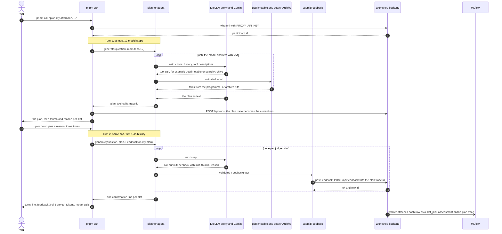
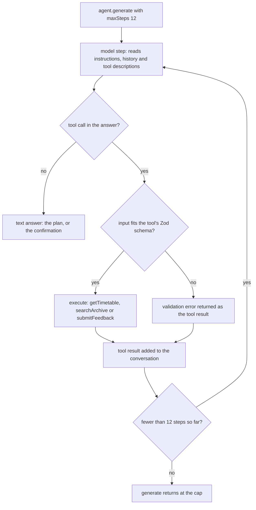

# talk-picker

**Production Agentic AI in TypeScript: Build a Self-Improving Talk Picker with Mastra, MLflow and GEPA**
Frontmania 2026, Jaarbeurs Utrecht, Wednesday 7 October, 11:00 to 12:45.

## You are on 03-done: the solved exercise

This branch is `03-start` plus the solution of exercise 3, agent with tools
plus feedback. The planner agent takes one free-form request ("plan my
afternoon, no Angular, something on accessibility"), calls its tools to
plan the three afternoon slots, and then records your thumb and reason per
slot through a tool you define.

What changes compared with exercise 2:

- **The model chooses the order.** In the `plan` workflow you fixed the
  steps in code. Here the agent decides at run time which tool to call and
  when, in a loop of model steps (ReAct: reason, act, observe). `pnpm ask`
  caps that loop at 12 model steps per turn, so a confused agent cannot run
  up your key.
- **Tool descriptions are prompts.** The model reads the description of
  `submitFeedback` to decide when to call it. "Once per slot" and "only after
  the user gave a verdict" decide how many rows you get and whether the agent
  ever makes one up.
- **Feedback lands on the trace.** Each verdict is stored under your
  pseudonym and attached to your plan's trace in MLflow as a `slot_pick`
  feedback assessment: a label from a human, on the exact run it judges.

### If you came here because you were stuck

You switched with `pnpm run switch 03-done` (or `git stash` and
`git checkout 03-done`). Your own edits are in `git stash list`;
`git stash pop` on `03-start` brings them back after the session. Steps 1
and 2 are done here. Run step 3:

```
pnpm ask "plan my afternoon, no Angular, something on accessibility"
```

That question is also the default, so plain `pnpm ask` asks it too. No
profile is needed: the planner works from your question only. Wait 10 to 30
seconds for the plan, then answer the three prompts, one slot at a time:
`up` or `down`, then a short reason about the talk. A typo asks the same slot
again. Then:

```
pnpm check:03
```

Done is `check:03 passed: 16 OK, 0 FAIL, 0 BLOCKED (static + live, <ms> ms)`,
and its `feedback rows on your plan trace` line shows your three reasons. A
`waiting for MLflow to attach the 3 feedback rows …` line may appear first,
because the backend attaches rows in the background.

Workbook, block 3: copy the `tools:` line from `pnpm ask`, for example
`tools: getTimetable -> searchArchive -> searchArchive -> searchArchive`.
Yours may differ; the order is the model's choice. The
`tokens: <turn 1> + <turn 2>  model calls: <n>` line is the cost of one run.

The check passes on this branch, and it counts the same as on your own
branch. Your verdicts are yours whichever branch the agent came from.
Nobody checks.

A terminal that cannot ask questions? Pass the verdicts as a flag, in the
order 14:15, 15:30, 16:30, separated by semicolons:

```
pnpm ask --feedback "up:reason one;down:reason two;up:reason three"
```

No backend or no wifi? `pnpm check:03 --static` runs offline, and
`MODEL_MODE=mock pnpm ask --feedback "up:a;down:b;up:c"` runs the agent with a
scripted tool loop; the rows then exist only in memory, so run `pnpm ask` live
once when the backend is back.

### What the solution looks like

#### Step 1: the `submitFeedback` tool

`src/mastra/tools/submit-feedback.ts`:

```ts
export const submitFeedback = createTool({
  id: SUBMIT_FEEDBACK_ID,
  description:
    "Records the user's verdict on one afternoon slot of the plan: thumb up or down and the user's own reason. Call it once per slot the user judged, only after the user gave a verdict, never on your own judgement.",
  inputSchema: FeedbackInput,
  outputSchema: z.object({ ok: z.boolean(), id: z.string().optional() }),
  execute: async (input) => postFeedback(input),
});
```

The description is the part the model reads; the check wants at least 40
characters and this one has 209. Its three clauses map to three failure
modes: too many rows, too few, and invented verdicts.

`FeedbackInput` (in `src/schemas/feedback.ts`, shared with the backend) is
the guard:

```ts
export const FeedbackInput = z.object({
  slot: Slot,
  thumb: z.enum(['up', 'down']),
  reason: z.string().min(1).max(MAX_REASON_LENGTH),
});
```

`Slot` rejects `13:30`, the enum rejects `meh`, and `MAX_REASON_LENGTH`
(280) rejects an essay. Mastra validates the tool input before `execute`
runs; a bad call goes back to the model as a validation error, and the model
can retry. In the pinned `@mastra/core` 1.71.0, `execute` gets the validated
input as its first argument (older examples destructure `{ context }`).

`postFeedback` (in `src/feedback/client.ts`) attaches the verdict to the
trace of the current run, which `pnpm ask` sets to the plan of turn 1. That
is why the rows land on the plan you judged, not on the feedback turn.

#### Step 2: the planner's tools and instructions

`src/mastra/agents/planner.ts`:

```ts
export const PLANNER_INSTRUCTIONS = `You plan the Frontmania 2026 afternoon for one attendee. The afternoon has three slots: 14:15, 15:30 and 16:30.

When asked for a plan:
- Call getTimetable first. Recommend only talks and ids it returned; never invent a talk.
- Plan all three slots in one answer: for each slot one talk with its id, title and one sentence on why it fits.
- Respect every constraint the user states (a technology to avoid, a topic they want). If no talk in a slot fits, say so and name the least bad option.
- For each slot call searchArchive once with the chosen talk's topic and add one related recording from an earlier edition (id and title) as preparation.
- End by asking for a thumb up or down per slot with a short reason.

When the user gives verdicts on the plan:
- Call submitFeedback once per slot they judged, with that slot, their thumb (up or down) and their reason in their own words, shortened to 280 characters if needed.
- Do not call submitFeedback for a slot they did not judge, and never make up a verdict.
- Confirm in one line per slot what you recorded.

Be brief and concrete. No marketing language.`;
```

"Call getTimetable first" and "only ids it returned" keep the plan grounded
in the programme instead of the model's memory. "Say so when nothing fits"
matters on purpose: 15:30 has no accessibility talk, and an honest agent
says that rather than stretching a CSS talk to fit. The second block is the
feedback rule; the tool description says when, the instructions say how.

And in `createPlannerAgent`:

```ts
    tools: { getTimetable, searchArchive, submitFeedback },
```

The keys are the tool names the model sees; the check wants exactly these
three. `getTimetable` and `searchArchive` are given: the first returns the
talks of one slot or all three from `data/program-2026.json`, the second is
the archive search from exercise 2.

#### Step 3: what `pnpm ask` does

`scripts/ask/run.ts` runs two turns with the same agent and the same step
cap:

```ts
export const MAX_AGENT_STEPS = 12;
```

```ts
const turn1 = await agent.generate(question, { maxSteps: MAX_AGENT_STEPS, tracingOptions });
```

Turn 1 sends your question and returns the plan. That run becomes the
current run. Turn 2 sends your verdicts as one message
(`Feedback on my plan: 14:15 up because …`), with turn 1 as history, and the
agent calls `submitFeedback` once per slot. The `tools:` line shows turn 1
only; the three `submitFeedback` calls show up in the `feedback:` line.



The loop inside one turn, with the cap:



`pnpm check:03` proves this in two layers. The static layer (11 lines,
offline, scripted mock planner) checks the markers, the schema bounds, the
description, the three tools, the instructions and a mock two-turn run with
three feedback rows. The live layer finds your last `pnpm ask` run, your
three rows on its trace at the backend, their `slot_pick` assessments in
MLflow, and the tool-call order.

### Next

Stay on this branch. At 12:25 the trainer shows the reveal: the optimizer's
score before and after, the prompt diff, and the move of the `production`
alias of the ranker prompt. After the alias moves, rerun exercise 2's
workflow here:

```
pnpm plan
```

`askRanker` loads the prompt by alias on every run, so this plan uses the new
prompt without a code change. Compare the `top picks:` line with the three
ids in your workbook; the `changed since last run:` line names the slots
whose top pick moved. No profile of your own? Add
`--profile data/cvs/profiles/<persona>.json`, the same persona as in block 2.

## The workshop

In 105 minutes you build an agent that reads your CV and picks your Frontmania
talk for 14:15, 15:30 and 16:30, with every step traced and your CV masked;
then you watch the room's feedback rewrite the ranking prompt and you judge,
with the numbers on screen, whether it got better.

| Clock | Segment                                                         | Branch                  |
| ----- | --------------------------------------------------------------- | ----------------------- |
| 11:00 | Welcome, blind pick, Codespace, privacy, demo                   | `00-setup`              |
| 11:12 | Block 1: CV to typed profile (6 theory, 11 exercise, 3 debrief) | `01-start` -> `01-done` |
| 11:32 | Block 2: ranker per slot plus retrieval (7, 14, 4)              | `02-start` -> `02-done` |
| 11:57 | Two-day training and flyer                                      |                         |
| 11:59 | Block 3: agent with tools plus feedback (6, 15, 5)              | `03-start` -> `03-done` |
| 12:25 | Reveal: score before and after, prompt diff, alias move         | `final` (trainer)       |
| 12:37 | Production checklist, closing                                   |                         |

The models are Gemini on Google Vertex AI behind a LiteLLM proxy run by the
trainer. You never hold a Google key: the proxy key in `.env` is all you
need. Archive search (exercise 2) uses the `text-embedding-005` embedding
model, 768 dimensions.

## Start here

1. Open the repo in a Codespace:
   [Open in GitHub Codespaces](https://codespaces.new/Randynamic/frontmania-ai-workshop?quickstart=1)
   (the prebuild has already installed everything). The same URL is on the
   first slide and on your card. Or locally with Node 22: `corepack enable`,
   `pnpm install --frozen-lockfile`, `cp .env.example .env`.
2. Get your `.env` from the key page <https://key-picker-788920378573.europe-west4.run.app> (QR and room code on the first
   slide) and paste it over `.env`, or paste a reserve card's key as `PROXY_API_KEY`. It is the only
   secret you get; it authenticates the model proxy, trace ingestion and the
   workshop backend. It dies at 13:00.
3. Run `pnpm run doctor`. Every line must say `OK`; the last line prints your
   id, for example `You are otter-42`. (`pnpm doctor` without `run` starts
   pnpm's own built-in doctor, which is not this script.)
4. Open the blind-pick page on your phone (QR on the screen, or
   `<WORKSHOP_BACKEND_URL>/pick`), enter the id and the 8-character pick code
   from your card, and pick one talk per afternoon slot before the demo
   starts. Your picks are final once saved (a second submit answers 409, a
   wrong code 403), so check them before you submit.

## Privacy

- Your CV goes to Google (Vertex AI, region Netherlands) through our proxy to build your profile. We don't store it.
- CV text is masked in traces. We keep your profile and picks under a pseudonym.
- Your `pnpm ask` question, your plan and your feedback reasons also go to Google Vertex AI through our proxy, and stay in the traces until 18:00.
- All workshop data is deleted today at 18:00.
- Prefer not to? Use a sample CV or type your skills.

`pnpm run profile` never writes your CV to disk; traces carry a hash marker
(`[cv:sha256:...]`) where the text was, also when a model echoes only your
name or employer. Those are read from the text itself, markdown or plain: the
capitalised words of its first three lines, every capitalised word that is
not a heading, job title or technology, and, in any letter case, the value
after a `Name:` or `Naam:` label, links and `@handles`, Dutch postcodes and
the word after "at" or "bij" (`src/observability/identity-fields.ts`). A name
you write only in lowercase and without a label is not recognised. See `src/observability/mask.ts` (the processor),
`src/observability/identity-hints.ts` (name, employer and place fragments),
`src/mastra/index.ts` (where it is wired into every trace) and
`src/mastra/index.test.ts` (an agent run whose exported spans carry the
marker and none of the CV). The profile itself has no name, employer or
contact field by schema (exercise 1), and `pnpm run profile` replaces any
name or employer the model echoes inside a value with the same hash marker
before the profile is saved or sent (`src/observability/echo-scrub.ts`).

Using your own CV? Paste it instead of saving it: run
`pnpm run profile --cv -`, paste the text, then press Ctrl-D on an empty line.
Nothing is written to disk. If you do save it as a file, use `private/cv.md`
(`mkdir -p private` first): `private/` is git-ignored, so it cannot be
committed by mistake, and `pnpm run switch` leaves it where it is (a CV
elsewhere in the tree would be stashed away on the next branch change).

In a GitHub Codespace every file, a saved CV included, sits on GitHub
(Microsoft) infrastructure until you delete the Codespace. Who owns it depends
on a setting the trainer chooses: under User ownership (the default for this
workshop) it is owned and paid for by your own GitHub account, Upgraide cannot
open it and our 18:00 deletion cannot reach it; under Organisation ownership
the organisation pays for it and Upgraide deletes it at 18:00. The trainer
says which one applies at the start. Either way, before you leave today:
`rm -rf private/`, then delete the Codespace at <https://github.com/codespaces>
(`...` menu, Delete).

From exercise 3 on we also keep your plan feedback: the thumb and the reason
you type for each slot in `pnpm ask`, under your pseudonym, in the workshop
backend and as `slot_pick` feedback on your plan trace in MLflow. The reason
and your question pass through our proxy to Google Vertex AI, like the plan itself. It
is deleted with everything else at 18:00. Keep reasons about the talks, not
about you.

## Branches

| Command                    | What you get                                                                                   |
| -------------------------- | ---------------------------------------------------------------------------------------------- |
| `pnpm run switch 00-setup` | foundation: Mastra instance with masked tracing, data, infra, shared schemas; no exercise code |
| `pnpm run switch 01-start` | exercise 1 skeleton: Profile schema and profile agent instructions                             |
| `pnpm run switch 01-done`  | exercise 1 solved                                                                              |
| `pnpm run switch 02-start` | exercise 2 skeleton: rankSlot, parallel fan-out, retrieval tip                                 |
| `pnpm run switch 02-done`  | exercise 2 solved                                                                              |
| `pnpm run switch 03-start` | exercise 3 skeleton: submitFeedback tool, planner agent with three tools                       |
| `pnpm run switch 03-done`  | exercise 3 solved (you are here)                                                               |
| `pnpm run switch final`    | 03-done plus the trainer-only optimizer (`optimize/`, Python)                                  |

Each exercise has a done criterion: `pnpm check:01`, `check:02`, `check:03`.
It fails on the start branch with a message that names what is missing and
passes on the done branch. This branch has all three.

`pnpm run switch <branch>` keeps your work and changes branch in one go: it
runs `git stash --include-untracked` when you have changes, then
`git checkout <branch>` (a plain `git checkout` refuses to leave a branch whose
exercise files you edited). Your work stays in `git stash list`; `.env`,
`.talk-picker/` and `private/` are git-ignored and stay where they are.

**Stuck for 8 minutes? `pnpm run switch NN-done` and keep going. Nobody checks.**
By hand it is two lines: `git stash --include-untracked`, then `git checkout NN-done`.

## When it misbehaves

| Symptom                                         | Fix                                                                                                                                         |
| ----------------------------------------------- | ------------------------------------------------------------------------------------------------------------------------------------------- |
| proxy 401                                       | wrong key: re-paste `PROXY_API_KEY` in `.env`                                                                                               |
| proxy 429                                       | you hit the per-key rate cap; wait 10 seconds                                                                                               |
| `ERR_PNPM_NOT_IMPLEMENTED`                      | you typed `pnpm profile`; write `pnpm run profile` (and `pnpm run doctor`: plain `pnpm doctor` is pnpm's own doctor)                        |
| Zod error from `pnpm run profile`               | the model's answer broke the schema; the message names the field, run it again (structured output is validated, not guaranteed)             |
| trace not found                                 | the exporter batches; wait 10 seconds and run the check again                                                                               |
| `pnpm check:01` trace never found               | your last `pnpm run profile` was a mock run (`participant: mock`); run it again without `MODEL_MODE=mock`, then the check                   |
| backend unreachable at `<url>`                  | the message names the host and the cause; run the same command with `MODEL_MODE=mock` in front to keep working offline and tell the floater |
| `pnpm plan` says no profile                     | run `pnpm run profile` first, or `pnpm plan --profile data/cvs/profiles/<persona>.json`                                                     |
| `pnpm plan` names a wrong talk id               | the ranker answered with an id outside the slot (`ForeignTalkError`); run it again                                                          |
| `pnpm ask` says no terminal to ask for verdicts | pass them as a flag: `pnpm ask --feedback "up:reason;down:reason;up:reason"`                                                                |
| `pnpm ask` records 0 of 3 verdicts              | the planner did not call `submitFeedback`: check its description and the instructions' feedback rule, then run `pnpm ask` again             |
| `pnpm check:03` finds fewer than 3 rows         | the agent submitted fewer verdicts than slots; run `pnpm ask` again and answer all three thumb prompts                                      |
| `pnpm run doctor` FAIL on data                  | ask the floater: the trainer rebuilds the vector index (`pnpm ingest` needs a trainer key); a missing file is `git checkout -- data`        |

## What is deliberately not here

Memory, streaming to the UI, chunking strategies, evals as a safety net,
deployment. Today you build one workflow and see one optimization run. In two
days you build memory, streaming to the UI, chunking strategies and evals as
a safety net, up to production:
[academy.upgraide.nl/frontmania](https://academy.upgraide.nl/frontmania?utm_source=flyer&utm_medium=print&utm_campaign=frontmania-workshop)
(22 to 23 November or 12 to 13 December 2026, EUR 807.50 excl. VAT with the
Frontmania discount, max 20 per session).

## Developer commands

`pnpm typecheck`, `pnpm lint`, `pnpm test`, `pnpm test:coverage`,
`pnpm format` (Prettier check), `pnpm check:01 --static`,
`pnpm check:02 --static`, `pnpm check:03 --static` (offline, what CI runs);
`MODEL_MODE=mock pnpm plan --profile data/cvs/profiles/<persona>.json` runs
the workflow offline with canned answers, and
`MODEL_MODE=mock pnpm ask --feedback "up:a;down:b;up:c"` runs the agent
offline with a scripted tool loop. Trainer-side:
`pnpm rank-once --profile <json> --slot <slot> [--render-only]` (the
contract-test partner of the optimizer), `pnpm keys:create`,
`pnpm keys:revoke`, `pnpm data:delete`, `pnpm smoke`, `pnpm ingest`; the
stack itself is in `infra/` (see `infra/README.md`).
